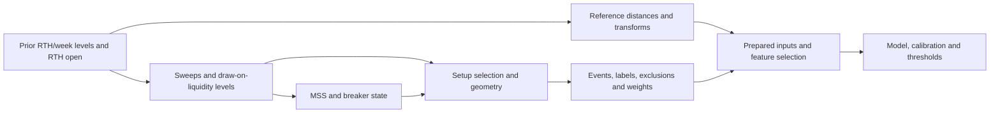
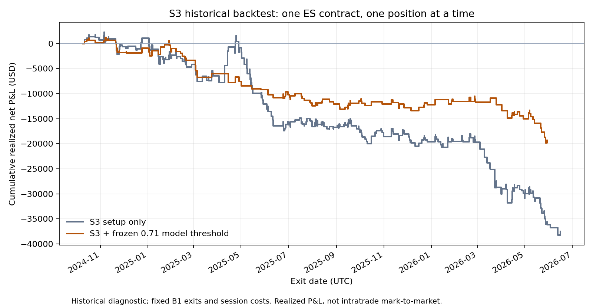
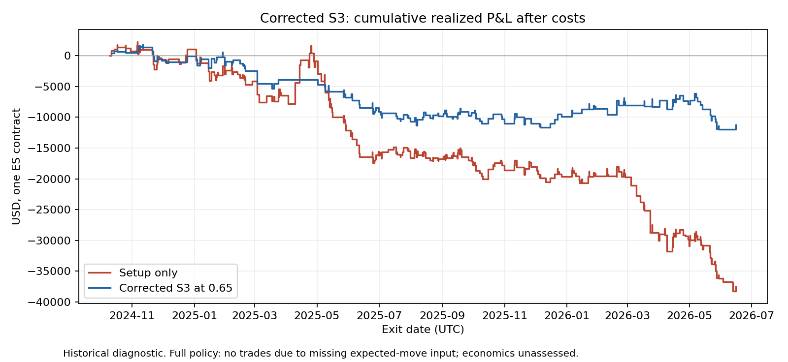
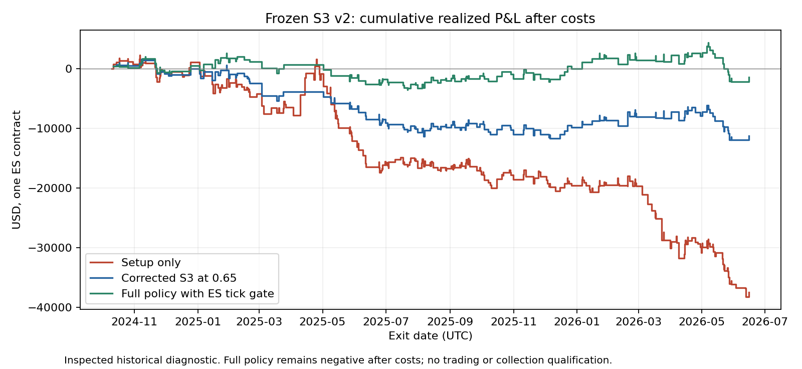

# B2 lineage, data repair and retraining (2026-09-18 to 2026-10-01)

Consolidated, chronological record of B2: saved-artifact lineage and dependency trace, measured impact and minimum repairs, the retention roster, shared-data repair, retraining readiness and validation repair, the retraining plan and first-pass/exploratory reviews, the S3 backtests and the ES expected-move contract, candidate source-history repair for the 12-model core and the IDs 5/14/18/23 catch-up, and the research scope. Machine-readable evidence is under `docs/audits/b2_*`. The superseding feature-contract v2 retrain (R1-R3, 2026-10-05 to 10-07) is recorded in `section4_progress.md`.

Contents:
- [B2 lineage inventory and dependency trace — 2026-09-18](#b2_lineage_inventory_and_dependency_trace_20260918)
- [B2: measured impact and minimum repairs](#b2_minimum_repairs_20260919)
- [B2: models to retain](#b2_model_retention_roster_20260920)
- [B2 shared-data repair](#b2_shared_data_repair_20260921)
- [B2 retraining readiness audit — 2026-09-22](#b2_retraining_readiness_audit_20260922)
- [B2 validation repair — 2026-09-22](#b2_validation_repair_20260922)
- [B2 model retraining plan — 2026-09-22](#b2_model_retraining_plan_20260922)
- [](#b2_first_pass_review_and_queue_20260922)
- [B2 exploratory S3/S5 review — 2026-09-24](#b2_exploratory_review_20260924)
- [B2 S3 historical backtest — 2026-09-27](#b2_s3_backtest_20260927)
- [S3 training/runtime history repair — 2026-09-27](#b2_s3_source_history_repair_20260927)
- [Corrected S3 historical backtest — 2026-09-27](#b2_s3_corrected_backtest_20260927)
- [ES expected-move and spread units — 2026-09-27](#es_expected_move_contract_20260927)
- [S3 completed full-policy comparison — 2026-09-28](#b2_s3_full_policy_backtest_20260928)
- [B2 candidate history and missing-value audit — 2026-09-28](#b2_candidate_history_audit_20260928)
- [B2 research scope — 2026-09-29](#b2_research_scope_20260929)
- [B2 candidate-history/source-history completion — 2026-09-30](#b2_candidate_history_minimum_and_expanded_core_20260930)
- [B2 candidate-history catch-up — IDs 5 / 14 / 18 / 23](#b2_candidate_history_catchup_5_14_18_23_20261001)
- [Catch-up of IDs 5 / 23 / 14 / 18 — progress](#catchup_ids_5_23_14_18_progress)


<a id="b2_lineage_inventory_and_dependency_trace_20260918"></a>

## B2 lineage inventory and dependency trace — 2026-09-18

*Merged 2026-10-09 from `docs/B2_lineage_inventory_and_dependency_trace_20260918.md`.*

The inventory and dependency-tracing stage is complete for the saved artifacts
discovered in this checkout. **B2 itself remains open.** No historical features,
labels, prepared datasets, models, calibrations, policies, runtime manifests or
baseline eligibility flags were changed. This stage does not authorize training
or start a qualified evaluation period.

The evidence establishes defects in saved parent datasets and identifies their
declared descendants. It does **not** establish the number of changed training
rows, changed labels, or required retraining jobs. Those are the next impact-review
stage. An artifact can reference a defective parent while its particular filtered
training rows remain unaffected; that must be tested, not assumed either way.

**Review artifacts**

| Artifact | Contents |
|---|---|
| [Model inventory CSV](audits/b2_lineage_20260918_complete/models.csv) | Every trained bundle, IDs, prepared parent, label/raw ancestors, selected dependency routes, missing ancestry, observed bundle hash and current audit disposition |
| [Per-model defect matrix](audits/b2_dependency_trace_20260918/model_defect_matrix.csv) | Which numerically witnessed parent each model references; selected fallback helpers; unresolved ancestry; explicit unmeasured-impact flags |
| [Full inventory JSON](audits/b2_lineage_20260918_complete/inventory.json) | Training/configuration metadata, selected features, lags/windows, calibration/threshold metadata, split/fold metadata, registrations, runtime records, graph and file identities |
| [Dependency edges](audits/b2_lineage_20260918_complete/edges.csv) | Parent → child, relationship, evidence file, JSON pointer and evidence type |
| [Dataset consumers](audits/b2_lineage_20260918_complete/dataset_consumers.csv) | Saved data tables and their declared model descendants; unlinked tables remain explicitly unclassified |
| [Selected feature dependencies](audits/b2_lineage_20260918_complete/selected_feature_dependencies.csv) | Exact selected names, transformed base names and reviewed dependency routes |
| [File identity inventory](audits/b2_lineage_20260918_complete/files.csv) | Existence, size, SHA-256 and stable-read status; directories and absent references are distinguished |
| [Registry bindings](audits/b2_lineage_20260918_complete/registrations.csv) / [runtime bindings](audits/b2_lineage_20260918_complete/runtime.csv) | All historical/research registry variants and standalone/bundled runtime manifests |
| [Numerical witnesses](audits/b2_dependency_witnesses_complete_20260918.json) | Bounded saved-data comparisons for ICT, four FRVP label roots, OTE 5m and native 1m, plus retrospective confluence reproduction |
| [Dependency trace JSON](audits/b2_dependency_trace_20260918/dependency_trace.json) | 45 reviewed code anchors with hashes, model matrix, prepared-helper observations, frozen live-helper observations and preserved ES roster |
| [Prepared-root consumers](audits/b2_dependency_trace_20260918/prepared_root_consumers.json) | All 18 referenced prepared roots and every consuming bundle |

**Coverage and identity**

| Population | Count / treatment |
|---|---|
| Trained bundles with saved primary-model artifacts | **113**: 17 ICT, 46 FRVP, 50 OTE |
| Bundles under `models/` | 101, including archived/champion/live copies and unregistered trials |
| Additional trained research bundles | 10 FRVP placebo models under evaluation reports; two saved FRVP smoke models under `tmp/` |
| Registry registrations | 120, referencing 69 artifact paths; names are not treated as unique versions |
| Unregistered trained bundles | 44 |
| Runtime manifest records | 117 standalone/bundled records referencing 36 artifact paths; duplicate records are retained as bindings, not counted as independent models |
| Preserved ES roster | 21 entries, including retired/diagnostic entries; not proof of current process activity or candidacy |
| Auxiliary weights | Eight `.keras` files from confluence, regime and pattern-validation work, with available companion metadata/scalers; no primary-registry/runtime dependency was found |
| Temporary metadata-only fixtures | 20, enumerated in `discovery_exclusions`; no saved model weights, excluded from trained-model counts |
| Prepared roots | 18 |
| Referenced/discovered nodes and explicit dependency edges | 5,965 nodes; 2,775 edges |
| Stable file hashes | 5,442 files, 104,338,952,750 bytes; no parse/read errors or changed-during-read files |
| Models with missing declared ancestry | Nine: seven OTE variants and two temporary FRVP smoke runs |

Six pairs share the same observed inference-bundle fingerprint (weights, scaler,
calibrator where present, and model configuration), including copied S1/S6 and
ICT full/smoke long-meta artifacts. Their locations and training metadata remain
separate. The hash is not a claim of identical historical training consumption.

All 113 primary training summaries lack the explicit historical training-label
hash/version attestation needed for B2 certification. Saved summaries still provide
useful parent references. Current file hashes establish the bytes available now;
they cannot retrospectively prove the exact bytes read by an old training job.

There are 103 absent references across the larger inventory, including historical
report/output references. This is not 103 missing trained models. The model-specific
`missing_ancestor_paths` field identifies the relevant gaps. Native-1m feature and
prepared roots, sustained-breakout feature/prepared roots, two old short-breakout
challenger prepared paths, and the two smoke runs' old FRVP parents are missing.
Similar names or compressed alternatives were not silently substituted.

The eight auxiliary weight files remain unverified separately. Their names do not
establish that they produced the `htf_confluence_*` columns used by the primary
models. The actual helpers below are produced by labeling code.

**ICT reference defect: observed in the historical feature tape**

The saved `artifacts/ict_es_primary/phase02_features/ict_es_features.csv` contains
`ict_rth_open=2252.0` at **2017-01-02 23:00 UTC**. That is the opening price first
observed at **2017-01-03 14:30 UTC**, 15.5 hours later. The causal reference producer
leaves that overnight opening value unknown.

In the first 4,000 saved rows, the current causal reference calculation differs
on 2,694 `ict_rth_open` rows and 2,508 `ict_rth_gap_open` rows. Each audited prior-RTH
and prior-week reference differs on 255 rows. These counts describe this bounded
prefix only; the differences include missing-reference availability, not solely
future-value leakage. They are not changed-label counts.

The reviewed dependency paths are:



All **17 ICT bundles** reference this witnessed feature parent and select at least
one directly affected reference or its transform. The current nine-model ES ICT
roster is included. Seven bundles use the original prepared root; seven use the
July 24 refresh; three short specialists derive from the refresh's features/events.
The July refresh therefore does not prove a fresh causal feature build.

The source trace is specific: prior levels feed sweep detection and DOL target
selection; sweep state feeds MSS and breaker creation. Ordinary BOS/CHoCH,
ordinary order-block geometry, raw displacement, FVG geometry and swing-only
premium/discount ranges are **not marked reference-dependent solely because their
producer accepts the same frame**. The selected-feature CSV retains this distinction.

Correcting an opening-price predictor alone does not prove that labels change.
Labels require replacement where corrected sweep/DOL/setup inputs, event selection,
geometry, exclusions, quality or weights change. That comparison is still pending.

**Live confluence mismatch: selected in training and zero in saved live observations**

Seventeen bundles under `models/` select `htf_confluence_*`: 13 FRVP and four ICT.
The ten FRVP placebo bundles also select these helpers, for **27 total**. Exact
artifact versions and feature names are in the inventory; a reused model ID does
not collapse old and new versions.

The frozen September 11 SQLite snapshot was queried with `mode=ro` and
`query_only=ON`. Every observed helper value in the 13 model/manifest/feature
groups is zero. These groups cover eight model IDs:

- FRVP long continuation, short-continuation TCN, long meta, short meta, long S3 and long S5.
- ICT long meta and short meta.

Saved prepared training inputs contain nonzero values for the same selected
helpers. For example, the long-continuation FRVP training prefix has 1,355 nonzero
values among 2,000 rows, while all 2,160 linked frozen live snapshots for that model
contain zero. Long S3 has 885 nonzero values among its 1,407 training rows and zero
in all 1,409 recorded live snapshots. These observation totals include repeats
and revisions; they are not independent trades or a comparison on common dates.

There is a second dependency issue behind this mismatch. FRVP materialization
copies `compute_htf_swing_match` results into these predictors. That helper searches
a symmetric time window around the swing anchor and does not require its
confirmation to have arrived. A synthetic 10:00 event changes from unmatched to
matched when an 11:00 swing, confirmed at 12:00, is supplied. This can be a
retrospective label annotation, but it cannot be served as that same causal 10:00
predictor. Matching the offline helper by introducing the same future knowledge
into live inference would not repair it.

ICT helpers take setup HTF/structure alignment, then materialize it only for events
passing label exclusions. Their causal replacement must also review that
exclusion-conditioned population, rather than copying the final labeled tape.

The source chain is labeling → target-context inclusion → prepared feature
selection → saved selected names → live missing-producer zero fallback. The
existing input contract flags such fallback/unverified-producer cases; that gate
does not certify the old training input. Calibration-only repair cannot clear a
model whose fitted predictors used retrospective information.

**FRVP structural ATR: four saved label roots carry the defect**

The current, July refresh, August setup-target and post-2022 label tapes were
compared with their recorded raw sources. In each first-4,000-row sample, every
comparable full-hour row matches the original hour-open ATR reconstruction and
differs from an otherwise identical completion-stamped timing control:

| Label parent | Comparable rows / early-publication matches |
|---|---:|
| `frvp_es_primary_current` | 3,708 / 3,708 |
| `frvp_es_primary_refresh_20260701` | 3,708 / 3,708 |
| `frvp_es_primary_setup_targets_20260829` | 3,708 / 3,708 |
| `frvp_es_primary_post2022_20260703` | 3,828 / 3,828 |

Example: the 2017-01-03 13:00 UTC row contains ATR **3.1960796286907778**, using the
hour ending at 14:00. The timing-only control has **3.1919319078208375** from the
previously completed hour. The control is a diagnostic, not a replacement B1 or
training producer; gap, roll, warmup and actual-arrival rules still need validation.

The actual source path is `_resample_ohlcv` → `_detect_htf_swings` → unshifted
`map_htf_atr_to_ltf`. Its descendants include event ATR/size, HTF swing annotations,
barrier outcomes, entry scoring, label quality, exclusions, concurrency/weights
and materialized targets/helpers. Labels then merge with features before preparation.

All **34 FRVP bundles under `models/`**, plus **ten placebo bundles**, declare
ancestry through one of these four witnessed label roots. Recency weighting
retains its base prepared ancestry; it does not remove the earlier timing defect.
The two temporary smoke bundles reference older, missing prepared/feature parents
and remain unresolved rather than being attributed to a similarly named current run.

FRVP's detector feature `atr_14` is a separate dependency from the labeling
structural ATR. Setup detection must be compared on its real inputs; changing all
feature ATRs to hourly ATR would change strategy semantics. The clean B1 evaluator
has not repaired these historical label tapes.

**OTE: saved 5m and native-1m label tapes both publish HTF ATR early**

The combined labeling producer resamples to open-labeled 30m/1h buckets, then the
family labelers forward-map those timestamps. Reversal uses 1h; continuation and
breakout use 30m in the saved configurations. The saved ATR columns numerically
reproduce that mapping:

| Tape / family | Comparable rows / early-publication matches in the sampled prefix |
|---|---:|
| 5m reversal, 1h ATR | 3,792 / 3,792 |
| 5m continuation, 30m ATR | 3,870 / 3,870 |
| 5m breakout, 30m ATR | 3,870 / 3,870 |
| Native 1m reversal, 1h ATR | 3,060 / 3,060 |
| Native 1m continuation and breakout, 30m ATR | 3,300 / 3,300 each |

For example, the 5m reversal row at 2019-01-01 18:00 UTC uses ATR
**0.0023377870578316** from the bucket ending at 19:00, rather than the timing
control's **0.0015245399084341216**. Source metadata still says `as_provided`;
the original vendor's bar-open/bar-close convention must be resolved before
implementing the correction. The witnessed dependence on later source rows is
not cured by merely changing the metadata string.

The trace also includes HTF trend gates in continuation/breakout, event generation,
barriers, HTF confluence/quality, label helpers, and their downstream prepared
targets. The feature builder's continuation path prefers
`continuation_trend_*` columns already present in the labeled input, then falls
back to HTF EMA alignment. Thus checking only selected `htf_*` names would miss
derived continuation features. Meta/union labels inherit their component targets.

All **50 OTE bundles** declare ancestry through the witnessed label tapes: 46
through the 5m tape and four through native 1m. Seven have missing intervening
feature/prepared artifacts. The sustained-breakout variant inherits its ordinary
breakout parent; its extra target transformation does not erase that ancestry.

**Shared feature alignment and downstream fitted components**

The current HTF feature producer has an ES `bar_open` path with completed-bucket
checks and decision-close alignment; the default non-ES path remains
`legacy_right_closed`. These paths also differ in daily/weekly reference shifts.
Their historical/live compatibility requires a separate producer-version and
timestamp check from the label ATR issue. Eighty-four bundles select a reviewed
intraday-HTF/continuation/interaction route; 61 select calendar HTF reference routes.
These counts overlap and are dependency flags, not 145 distinct damaged models.

The inventory retains selected columns, broader prepared feature lists, rankings,
scalers, fold geometry, event-window sources, calibration and threshold metadata.
Changed labels/masks/weights can change training membership and fitted components
without changing the final selected feature names. Correlation filtering and
feature rankings can also inherit a bad candidate column that was later dropped.
Actual data/selection comparisons are needed before retaining those components.

**Disposition and remaining work**

- **111 bundles:** a defect is numerically observed in a saved parent identified by
  their declared lineage. Which consumed training rows and decisions changed is
  still unmeasured.
- **Two temporary smoke bundles:** dependency review remains necessary, with missing
  historical parents preventing the same saved-data proof.
- **Eight auxiliary weight files:** historical inputs and primary-model integration
  are unverified; they are not cleared from their names or architecture.
- **Zero models certified clean, zero replacements trained, zero baseline releases.**
  These are audit dispositions, not registry mutations or retirement decisions.

The next stage should compare corrected features and event/label inputs over the
actual consumed ranges, including source-row selection and fitted preprocessing.
That yields the minimum repair matrix: live producer only, feature/preparation
replacement, event/label replacement, calibration-only where justified, retraining,
or continued quarantine for missing proof. Broad retraining is not authorized by
this report. B1's pooled diagnostics-only scope, classic-breaker exclusion, S4 pause
and other prospective/promotion prerequisites remain in force.

**Reproduction and validation**

```powershell
ote_venv/Scripts/python.exe -B scripts/audit_b2_lineage.py --output-dir docs/audits/<new-inventory-directory>
ote_venv/Scripts/python.exe -B scripts/probe_b2_dependencies.py --output-file docs/audits/<new-witness-file>.json
ote_venv/Scripts/python.exe -B scripts/summarize_b2_dependencies.py --inventory docs/audits/<inventory-directory>/inventory.json --witnesses docs/audits/<witness-file>.json --output-dir docs/audits/<new-trace-directory>
```

The tools refuse existing output destinations and never load serialized models,
fit a learner, rewrite source artifacts or change runtime eligibility. Preservation
objects resolve relative to their capture manifests. External/foreign paths remain
unresolved instead of being read or guessed.

Validation: **82 distinct tests passed**: 14 new inventory regressions and 68 existing
ICT reference, ES causal-input and B1 scope/ATR tests. The new checks cover alias
identity, nested label ancestry, recency parents, research/temp discovery, missing
inputs, capture-object resolution, source preservation and conservative feature
dependencies. All 45 code anchors resolve. Audit output checksums and a final
source/artifact preservation check accompany the report. The
[validation record](audits/b2_lineage_validation_20260918.json) verifies all audit
output checksums, unchanged metadata for 5,442 inventoried files, and identical
rehashes for 1,667 model/runtime/source files. Narrow `.gitignore` exceptions retain
these review artifacts alongside the existing B1 evidence.

The missing A2/A3 standalone documents remain evidence gaps; their journal entries,
current code/tests, preserved source captures and the new saved-data witnesses were
used explicitly. No document was invented to stand in for the missing originals.


<a id="b2_minimum_repairs_20260919"></a>

## B2: measured impact and minimum repairs

*Merged 2026-10-09 from `docs/B2_minimum_repairs_20260919.md`.*

Execution update, 2026-09-21: the retained models' [shared-data repairs are complete](#b2_shared_data_repair_20260921). The proposal below records the earlier evidence; model retraining and release remain pending.

**Recommendation: repair the shared damaged data, then retrain only the affected models we intend to keep.** Archived experiments can stay archived.

We checked available training, validation and test rows for **104 of 113 saved model bundles**. Nine have missing historical files. This is a proposal for review. No production code, historical data, models or runtime settings were changed; no training was run.

**What the measurements show**

| Area | Measured impact | Smallest necessary repair |
|---|---|---|
| **ICT references — 17 models** | After correcting references and applying the usual missing-data handling, a selected input changes on **99.3–100% of each model's training rows**. | Rebuild reference features and their dependents. Replace labels only where setup selection, trade levels or other label inputs change. Rebuild prepared data and retrain retained affected models. |
| **FRVP hourly ATR — 34 models** | Delaying the hourly volatility measure until it was available changes **1–107 training labels in every model**. | Correct ATR timing; recalculate affected outcomes, label quality and weights. Rebuild prepared data and retrain retained models. Preserve the separate local-ATR detector and independent features unless their checks find a defect. |
| **Training/live helper mismatch — 27 overlapping bundles** | Selected helpers are nonzero on **10.0–76.0% of training rows**. The live audit found only zeros for eight observed model IDs. Ten bundles are placebo controls. | Remove predictors that depend on later information, or replace them with a proven calculation used identically offline and live. Retrain retained consumers; changing the live default cannot undo past training. |
| **OTE timing — 43 models with prepared data available** | Assuming timestamps mark bar opening, **37 models** have changed selected higher-timeframe predictors on almost every training row. The other **six** still require dependent-feature and label checks. | Verify the timestamp convention first. Correct 30-minute/hourly publication and dependent features. Replace changed labels, exclusions and weights; retrain retained models whose fitting inputs changed. |
| **Missing history — nine bundles** | Seven OTE models and two FRVP smoke models lack required historical files. | Keep excluded from the trusted baseline. Recover and verify the exact parents if needed; otherwise leave the branch retired. |

For FRVP, holding the saved setups and trading rules fixed produced these changes:

| Saved label batch | Target-hit labels changed / comparable non-excluded events |
|---|---:|
| Original | 278 / 16,410 — **1.69%** |
| July refresh | 283 / 17,005 — **1.66%** |
| August setup targets | 269 / 16,433 — **1.64%** |
| Post-2022 | 137 / 8,109 — **1.69%** |

These batches overlap; do not add their counts. Holding times also change for **14.7–15.3%** of these events, requiring weight and overlapping-trade checks. These are timing comparisons with fixed saved setups, not complete relabel counts or estimates of lost profit.

OTE's saved ATR timing also differs on **91.6% of comparable 5-minute reversal rows** and **83.3% of continuation/breakout rows** under the same timestamp assumption. The native 1-minute label tape is affected too; its missing prepared data prevents model-level clearance.

**Repair order**

1. **Preserve raw prices and historical versions.** Repair each shared data calculation once; save replacements with new versions and exact parent records.
2. **Rebuild affected features; compare labels.** Check setups, entries, stops, targets, exclusions and weights. Reuse independent features and unchanged labels. Complete ICT and OTE label comparisons remain necessary.
3. **Rebuild training packages for retained models.** Refit data preparation and include affected lagged inputs. Retrain when fitting inputs changed. Recalibration alone is sufficient only if fitting was demonstrably unaffected and damage was confined to calibration or threshold selection. Use development data, not the new evaluation period.
4. **Verify replacements.** Future bars must not rewrite earlier predictors; historical and live calculations must agree. Assign new versions, re-evaluate with B1, freeze thresholds and start a fresh clean evaluation period. Existing roster restrictions still apply.

**Current disposition:** 51 model bundles have confirmed fitting-data changes: 17 ICT and 34 FRVP. OTE needs the timestamp decision and remaining comparisons. Keep the ten placebo controls archived unless their experiment is needed again. The eight separate auxiliary weight files remain unverified and have no demonstrated dependency on these primary models. **No model has been newly certified clean, rebuilt or released by this audit.**

The [repair list for every model](audits/b2_model_minimum_repairs_20260918.csv) contains exact versions and counts. Supporting [measurements and limitations](audits/b2_impact_20260918/README.md) distinguish confirmed changes from assumptions and unresolved history.


<a id="b2_model_retention_roster_20260920"></a>

## B2: models to retain

*Merged 2026-10-09 from `docs/B2_model_retention_roster_20260920.md`.*

Data update, 2026-09-21: [replacement data is built and checked](#b2_shared_data_repair_20260921) for the 27 retained models. Training priorities and all model restrictions below remain in force.

**Repair four models first, then two exploratory specialists.** Preserve the established background comparisons, but do not automatically retrain every historical version.

This selects the repair queue. It does not authorize a training run, change the running roster, or certify any old model as clean. All existing B1, shadow-only, economics and promotion restrictions remain.

**First repair pass**

| Model | Why keep it |
|---|---|
| FRVP long-continuation **XGB** | Existing A9 focused research priority. |
| FRVP short-continuation **TCN** | Existing A9 comparison priority. Keep it research-only: its earlier cost and drawdown failures still matter. |
| ICT long-continuation **XGB** | Existing A11 priority after causal inputs are repaired. This does not override its weak discrimination and concentration findings. |
| ICT short premium/discount-continuation specialist **XGB** | Existing A11 focused specialist comparison. |

Use the July-refresh FRVP bundles, July 26 full ICT bootstrap bundle, and August 11 ICT specialist bundle as the recipe/lineage references. Their contaminated weights are not clean starting points. Exact artifact paths and recorded bundle identities are in the [complete selection CSV](audits/b2_retention_roster_20260920.csv).

**Next: retain two exploratory models**

- FRVP long **S3 XGB**: exploratory specialist.
- FRVP long **S5 XGB**: retain for same-side coverage; short-S5 observations do not establish long-S5 quality.

Repair their shared inputs with the first pass where appropriate. Schedule their retraining after those inputs and the first replacements pass verification.

**Retain 13 background comparisons; defer their retraining**

- **FRVP, six:** long reversal, long/short meta, and long S1/S2/S6 specialists.
- **ICT, seven:** long reversal, long/short meta, short reversal, short continuation, short IFVG and short sweep-reclaim specialists.

Keep one established roster version per model, including the selected full-span rerun2 S1/S6 versions. Keep their existing artifacts and diagnostic history. Until repaired, old scores must be identified as legacy diagnostics and excluded from the trusted baseline. If a background model is later needed in a clean comparison, repair that branch before admitting it.

**Retain OTE's eight registered representatives conditionally**

Keep long-reversal TCN, short-reversal XGB, long/short meta TCN, long/short breakout TCN, and long/short union TCN from `models/ote_model_registry_live_multifamily.json`.

Resolve OTE's source timestamp convention and remaining impact checks before scheduling replacements. Preserve pooled-model diagnostic restrictions and short-breakout shadow restrictions. Do not automatically revive missing-history native-1m experiments, backups or the unregistered long-breakout XGB alternative.

**Outside the automatic repair queue**

| Treatment | Bundles | Decision |
|---|---:|---|
| Keep paused | 1 | FRVP long S4: preserve artifacts and diagnostics; a model-specific policy is required before reopening candidacy. |
| Keep retired | 1 | FRVP short reversal: do not reopen for B2. |
| Quarantine missing history | 9 | No recovery work now. Restore exact parents only if a later research need justifies reopening the branch. |
| Archive placebo controls | 10 | Preserve the old experiment. Rerun only if a new control experiment is needed. |
| Archive other versions | 65 | Preserve older versions, duplicates, alternative backends and experiments; no automatic retraining. |

“Archive” here means **retain files but exclude them from the B2 repair queue**. No files are moved or deleted. The eight auxiliary weight files also stay preserved and unverified, with no retraining scheduled.

All **113 primary bundles** have exactly one disposition: 4 first, 2 exploratory, 13 background, 8 conditional OTE, and the 86 outside the automatic queue above. This is a workload decision based on the existing roster, not a new ranking derived from contaminated backtests. An archived version is not thereby declared a failed model.

Basis: [notes A9–A11 and parked restrictions](../notes.txt), the [captured ES roster](audits/b2_dependency_trace_20260918/dependency_trace.json), the current OTE registry, and the [measured repair requirements](#b2_minimum_repairs_20260919). Some A9/A11 report paths referenced in notes are absent from this checkout; this selection relies on the available notes and captured artifact identities. [Validation](audits/b2_retention_validation_20260920.json) records coverage and source identities.


<a id="b2_shared_data_repair_20260921"></a>

## B2 shared-data repair

*Merged 2026-10-09 from `docs/B2_shared_data_repair_20260921.md`.*

**Shared-data repair and validation are complete for the retained roster: 25 prepared datasets serve 27 models. No trading models were trained or released.**

- **OTE timing verified:** 538,586 complete five-minute candles match opening-time buckets from the local one-minute history. Preserve the existing timezone conversion. Provider identity remains unknown; the candle-membership check is recorded separately.
- **Historical labels reproduced:** ICT, both retained FRVP batches, and OTE reversal/continuation/breakout reproduced their saved labels before correction.
- **ICT repaired:** corrected references and their dependent features changed setup selection and trade outcomes. The new label run contains 15,376 events, including 14,844 usable events. All nine retained ICT models now have replacement prepared data.
- **FRVP repaired:** hourly volatility is published after the hour closes. A past higher-timeframe swing must also be confirmed before it can qualify a setup. Labels, quality scores, exclusions and weights have been rebuilt; independent profiles and local-ATR setups are preserved.
- **OTE repaired:** completed 30-minute/hourly information drives the new labels and features. The shared historical/live continuation calculation matches all 543,441 label-history rows.
- **Helpers removed from training:** label-derived `htf_confluence_*` values cannot enter new feature selection, even when old metadata declares them. Missing live helpers stay explicitly missing and their consumers remain diagnostic.
- **Old artifacts preserved:** 1,489 checked model/companion files and the OTE registry are unchanged. Nine missing-history bundles remain quarantined; no recovery is scheduled.

Examples of changed labels in the full historical tapes:

| Family | Long | Short |
|---|---:|---:|
| ICT continuation | 56 | 60 |
| FRVP July continuation | 114 | 154 |
| OTE reversal | 1,431 | 1,507 |

Quality scores, exclusions and weights also changed. These are changed label cells, not profit estimates. The complete comparisons are retained beside each new label dataset.

**Validation:** 127 regression tests passed. All 25 prepared datasets passed checks for chronological row identity, separation between splits, finite inputs/weights, binary targets and exclusion of label-derived helper predictors. Twelve important data parents and the checked historical models remain unchanged. FRVP long-reversal preparation retains its existing 730-day recency weighting and 0.20 floor.

Use the [new data location for each retained model](audits/b2_repaired_model_data_roster_20260921.csv). The scope follows the [retention roster](#b2_model_retention_roster_20260920): 19 ES models and eight OTE representatives. Paused, retired, archived and placebo branches received no automatic prepared-model rebuild. Existing model weights remain quarantined from the new trusted baseline.

After data verification, B2 still needs selected-model retraining, any necessary calibration, new model versions and B1 re-evaluation. Existing research, diagnostic and shadow restrictions remain. No old model becomes trusted merely because its replacement data is ready.

Evidence: [final validation](audits/b2_repair_validation_20260921.json), [execution and parent manifest](audits/b2_repair_execution_manifest_20260921.json), [timestamp check](audits/b2_ote_timestamp_fullspan_20260920.json), [FRVP quality/weights](audits/b2_frvp_quality_weight_validation_20260921.json), [OTE shared-context parity](audits/b2_ote_shared_context_parity_20260921.json), [label-window bounds](audits/b2_label_window_bounds_20260921.json).


<a id="b2_retraining_readiness_audit_20260922"></a>

## B2 retraining readiness audit — 2026-09-22

*Merged 2026-10-09 from `docs/B2_retraining_readiness_audit_20260922.md`.*

**Resolution added 2026-09-22:** both blockers below are repaired for the four priority jobs, with new frozen-selection prepared views, purged final fitting and validation-free refits. The [updated plan](#b2_model_retraining_plan_20260922) and [repair evidence](#b2_validation_repair_20260922) supersede the hold for those jobs only. Later groups remain deferred; no replacement training or activation was performed.

**Original audit verdict: hold the retraining plan as written.** The B1 contracts and repaired historical inputs are supported by evidence, but the trainer has two validation problems to fix before spending time on replacement models. No model training or activation was performed during this audit.

This reviews section 2 of [notes.txt](../notes.txt), the [retraining plan](#b2_model_retraining_plan_20260922), saved artifacts and the actual training code. The earlier plan preflight checked inputs and fold geometry; it did not audit the complete fitting path. Passing that check was insufficient to declare the plan ready.

| Prerequisite | Audit result | Does it block offline retraining? |
|---|---|---|
| B1: outcome contracts | Complete. Fresh check: 45 contracts, 37 defined risk entries, eight excluded placeholders, 120 registrations, zero unresolved included bindings. Catalogue and scope hashes unchanged. | No. |
| B2: inventory, retention and impact | Completed evidence retained; 27 selected models use 25 replacement prepared targets. Nine missing-history bundles remain quarantined. | No additional recovery is needed for this queue. |
| B2: causal shared-data repair | Recorded fixes, label comparisons, quality/weight checks and timestamp evidence are present. All 259 checked manifest references and prepared files match their recorded hashes. | The shared input repair is ready; validation preparation needs the targeted change below. |
| B2: retraining, calibration and new versions | Not completed. Two issues below prevent a clean validation claim. | **Yes.** |
| B3: prospective comparison design | Open: common opportunities, setup-only/threshold/full-policy comparisons, costs, limits, freshness and reporting windows. | Not required to fit historical models; required before collecting/scoring the new comparison. |
| B4: freeze approved baseline | Open: model, calibration, thresholds, setup and policy versions. | Follows replacement training and review; blocks qualified collection. |
| B5: eligibility and promotion criteria | Research priorities exist, but formal eligibility and promotion criteria remain open. | Does not prevent fitting; finish before judging candidates or promoting them. |

A12 latency measurements and A13 app end-to-end verification are also still open outside section 2. Qualified shadow collection is therefore **not ready**, independently of the training issues. Pooled models remain diagnostic-only, S4 stays paused, and existing economics/concentration/shadow restrictions remain.

**1. Feature selection sees some of its own validation labels.**

The prepared pipeline uses the whole outer training split to choose between correlated features and rank predictors. The trainer then creates smaller walk-forward folds inside that same split while reusing the already selected feature list. Consequently, validation labels have already influenced which inputs those folds receive.

For the first fold, this affects all 300 FRVP long-continuation validation rows, all 500 FRVP short-continuation rows, and all 128 validation rows in each priority ICT model. Each of these prepared training sets is smaller than the 100,000-row selection cap, so the entire training split is included in the selection analysis. This biases cross-validation and the resulting out-of-fold threshold/calibration evidence. It does **not** establish that the untouched outer test labels were used.

Source: `preprocessing/pipeline.py:591` and `:624`; `preprocessing/feature_selection.py:806`; `preprocessing/feature_importance.py:87`; `model_training/ote_training/ote_xgboost_pipeline.py:388` and `:2137`.

Minimum repair: either fit all learned preprocessing/feature selection inside each fold using its training rows only, or freeze selection on an earlier development segment and place every validation fold after that segment plus the required gap. Reranking the already globally pruned feature list is insufficient. Use the corrected pre-selection data to make the necessary new prepared views. Preserve the repaired raw features, labels, original versions and final test period.

**2. The final TCN fitting step reuses validation rows for training.**

All four priority recipes enable `final_refit_on_dev`. The first final fit takes a development tail as validation without enforcing the repaired label gap, and fits its scaler on the entire development set. The second fit trains on the entire development set while still passing that tail as validation. The TCN trainer uses validation performance to choose its best checkpoint and stop training.

A no-training probe replaced the fitting backend with a recorder: the second call included **175 of 175 validation rows in training**. In the actual priority FRVP TCN data, the first final-fit boundary leaves only **15–267 original bars**, depending on the window, against the required **1,071**. The main walk-forward folds do have sufficient gaps; this defect is in the later final-fit stage. XGBoost also receives the overlapping evaluation tail, but its current implementation uses fixed round counts rather than validation-based early stopping, so the checkpoint-selection consequence is specifically confirmed for TCN.

Source: `model_training/ote_training/ote_xgboost_pipeline.py:2330`, `:2356`, `:2410`; `model_training/ote_training/torch_trainer.py:641` and `:667`.

Minimum repair: use a genuinely separate, purged development holdout to choose the training duration, with its scaler fitted only on the fit portion. Then either retain that model, or refit on development data for a frozen duration without using those same rows to select a checkpoint. Merely setting `final_refit_on_dev=False` does not repair the first fit's missing gap or scaler boundary.

**What passed, and the remaining order**

- Fresh B1/B2 regression subset: **237 tests passed**. The historical 398-test B1 and 127-test B2 results remain historical evidence; this audit did not rerun both full suites.
- **259 files** matched saved hashes, including every recorded train/validation/test file for the 25 selected prepared targets. This is not a new full rehash of all legacy model weights or raw market history.
- All search-window choices in the first four jobs pass their configured training-positive, validation-positive and validation-event minimums. Corrected ICT event windows are available. No reduction of those safeguards is justified.
- Fix the two training-validation issues; add tests proving validation labels cannot influence earlier selection, final-fit gaps are enforced, and checkpoint-selection rows are held out.
- Version only the newly affected selection/prepared views, update the plan and lineage hashes, and rerun the first-pass preflight. Then retrain the four priority models and perform B1 evaluation. Later groups stay deferred as previously agreed.
- Complete B3–B5 and the remaining app verification before any qualified shadow period. Successful training alone grants no baseline clearance.

Evidence: [fresh contract audit](audits/b1_completion_recheck_20260922.json), [file checks, fold counts and no-fit probe](audits/b2_retraining_readiness_20260922.json), [regression results](audits/b2_readiness_tests_20260922.xml).


<a id="b2_validation_repair_20260922"></a>

## B2 validation repair — 2026-09-22

*Merged 2026-10-09 from `docs/B2_validation_repair_20260922.md`.*

**Follow-up, 2026-09-24:** the four priority runs are now trained and artifact-reviewed; frozen preparation and preflight also pass for the later queue. See the [first-pass review and queue evidence](#b2_first_pass_review_and_queue_20260922). The account below remains the historical repair record; its later-group deferral has been superseded for offline training. B1 evaluation and promotion remain pending.

**The two readiness-audit blockers are resolved for priority model IDs 2, 1, 11 and 17.** Their new prepared views and preflight are complete. The [updated retraining plan](#b2_model_retraining_plan_20260922) supplies runnable commands. No replacement model was trained or activated during this initial repair; only small synthetic backend tests fitted models in memory.

The [original audit](#b2_retraining_readiness_audit_20260922) remains historical evidence. Its reported leakage was real: globally selected features influenced CV, and final TCN checkpoint selection reused training rows.

The preparation repair uses an early development segment rather than fold-local feature lists. `PreprocessingConfig.target_selection_fit_rows` freezes all learned preparation for each target. The pipeline starts with the complete candidate pool from the corrected pre-selection parquet files, before global constant/duplicate removal. Categorical encoding (including unknown-category handling), filling, constant/duplicate/variance pruning, correlation pruning, optional scaling and ranking fit only on that prefix. Its row count, final source-row identity, required gap, encoders and fill values are saved in `report.json`. Later labels or feature distributions cannot alter those fitted choices.

The trainer checks this frozen-selection boundary against every walk-forward fold. The B2 runner requires the new contract, validates all input hashes and refuses later model IDs whose validation views have not been rebuilt. Legacy preparation remains readable elsewhere; that compatibility does not clear old globally selected views for B2 validation.

Final fitting now plans a separate purged development holdout, enforcing both the saved retained-row gap and the repaired original-bar gap. Its first scaler sees only the fit portion. With refitting disabled, that held-out model and scaler are retained. With refitting enabled, TCN freezes the selected epoch count, phase training fractions and actual learning rates; the second fit receives no evaluation rows and replays that schedule without validation-driven scheduling, stopping or checkpoint choice. The refit scaler may then use all development rows. XGB keeps its fixed round counts and also receives no evaluation rows in its refit. The final test period is never used to fit a scaler or select duration.

`training_summary.json` now records `final_holdout`, `holdout_training_history` and `refit_fixed_epoch_schedule`. TCN checkpoints distinguish `held_out_validation` from `fixed_duration_refit` and do not report an in-sample score as a validation score for the refit.

The four new views are under `artifacts/b2_validation_prepared_20260922_v1`. Preparation compared every train/validation/test `source_row_idx`, `target` and `sample_weight` against the prior repaired view with exact equality. Repaired parents and previous versions were preserved. A fresh check matched all 241 historical artifact/evidence references and prepared-file hashes checked across the retained roster; changed source code is recorded separately in the new preflight. New file hashes and parent links are in the [preparation manifest](audits/b2_validation_preparation_20260922.json); its SHA-256 is `3c2ddda7dcf50ecce087475112e863fd7fe42ae8bc808d30172303ad7c4becad`.

| Model | Frozen selection rows | Window choices | Minimum CV source gap | Final-holdout source gap range |
|---|---:|---:|---:|---:|
| 2: FRVP long continuation XGB | 900 | 9 | 10,235 | 11,438–11,881 |
| 1: FRVP short continuation TCN | 1,800 | 5 | 8,276 | 9,673–10,275 |
| 11: ICT long continuation XGB | 400 | 5 | 18,762 | 25,512–25,763 |
| 17: ICT short premium/discount continuation XGB | 400 | 5 | 19,171 | 23,844–28,401 |

Gaps count original bars strictly between the last training label row and first validation label row. They exceed the requirements because the saved minimum retained-row purge remains in force on sparse setup datasets. No safeguard was reduced. All 24 search-window choices pass saved training-positive, validation-positive and validation-event minimums. Corrected ICT windows cover every positive development row. The [preflight evidence](audits/b2_validation_repair_preflight_20260922.json) records per-fold counts, final boundaries, input hashes and code hashes.

Validation ran the original 237-test readiness subset plus preprocessing, trainer and new regression coverage: **305 passed, two skipped, one pre-existing failure**. The failure is `test_cross_validate_trial_respects_cv_max_folds`: the unchanged test supplies `cv_max_folds`, which is already absent from `OTETrainingConfig` in HEAD. Priority saved recipes do not use it and all load successfully. The two skipped tests require a prepared smoke dataset absent from this workspace. The [full results](audits/b2_validation_repair_tests_20260922.xml) retain the failure; [preservation evidence](audits/b2_validation_repair_preservation_20260922.json) records its HEAD provenance and historical hash checks.

New tests perturb all later labels, numerical distributions and category vocabularies and verify unchanged early selection, rankings and transformed fit rows. They verify the scaler boundary, original-bar purge, disjoint checkpoint-selection rows, both refit settings, rejection of invalid boundaries, fixed TCN duration despite forbidden evaluation, and actual XGB/TCN final-refit execution on synthetic data. All five plan PowerShell blocks parse, and the setup block's read-only preflight executes successfully.

To reproduce preparation into another version:

```powershell
.\ote_venv\Scripts\python.exe -B scripts/prepare_b2_validation_views.py --output-root artifacts/b2_validation_prepared_20260922_v2
```

Existing outputs are never overwritten. A newly generated version requires review of its manifest and updated runner pins before use. To repeat the current preflight without fitting:

```powershell
.\ote_venv\Scripts\python.exe -B scripts/run_b2_retraining.py check priority
```

Later groups remain deferred as agreed, including their selection-view regeneration. They must retain their own special weighting and saved recipes when scheduled. B1 evaluation, B3–B5, A12 and A13 remain open as described in the plan; these repairs do not grant trusted-baseline or qualified-shadow clearance.


<a id="b2_model_retraining_plan_20260922"></a>

## B2 model retraining plan — 2026-09-22

*Merged 2026-10-09 from `docs/B2_model_retraining_plan_20260922.md`.*

**The four priority models have been trained and their first-pass artifact review is complete.** The [review and queue evidence](#b2_first_pass_review_and_queue_20260922) records successful artifact checks and saved-model prediction replay, weak label diagnostics, and the later preparation requirements. B1 clean-period outcome evaluation remains open; this plan enables offline training only.

**Exploratory IDs 6 and 7 are trained and reviewed; all six completed candidates pass artifact review.** The [S3/S5 review](#b2_exploratory_review_20260924) found modest S3 discrimination and weak S5 ranking. The subsequent [S3 historical backtest](#b2_s3_backtest_20260927) lost money after costs in both setup-only and model-filtered branches; the model's loss per trade was worse. The subsequent source-history and expected-move repairs are complete; the corrected full-policy comparison remains negative after costs. Keep S3 research-only pending the remaining qualification work. All 27 recipes passed final preflight on 2026-09-24; background and OTE jobs remain individual scheduling choices.

Follow the [retention decisions](#b2_model_retention_roster_20260920) and use the [checked replacement data](#b2_shared_data_repair_20260921). Start from new weights and save new versions under `models/b2_retrained_20260922_v2`. Keep the nine missing-history bundles quarantined.

1. Corrected S3 source-history training/runtime review and the [completed full-policy historical comparison](#b2_s3_full_policy_backtest_20260928) are complete at threshold 0.65. The causal expected-move/ES tick contract is verified offline and in the app; full policy takes 169 trades, net -$1,460.63 after costs. Preserve the new research version, archived controls and thresholds; do not tune on this inspected period. Next complete the other candidates' history/outcome reviews, full live feature parity and collection-readiness work. `Invoke-B2Train 6` remains blocked.
2. Before any future candidate comparison, freeze the bindings and predeclare untouched evaluation data, opportunity sets and execution assumptions. Preserve the original S3/S5 thresholds of 0.71/0.65 and corrected S3's OOF-selected 0.65 on their respective versions. Do not tune against inspected historical backtests. S5 remains an optional comparison candidate; its own replacement-specific full-policy comparison remains pending.
3. Run background/OTE models only when needed for the comparison, checking their group first.
4. Keep all replacements outside the trusted baseline until calibration checks and B1 evaluation pass. B3-B5, A12 and A13 remain separate prerequisites for qualified collection.

The [runner](../scripts/run_b2_retraining.py) loads each complete saved recipe and seed. The extended manifest under `artifacts/b2_validation_prepared_20260922_v2` retains the four completed models' v1 views unchanged and adds 21 newly frozen targets for 23 later recipes. Every view starts from the complete corrected pre-selection dataset. Each target freezes learned preparation on its saved initial-training prefix; shared OTE meta/union targets use the earlier 180,000-row prefix, with separate training jobs and recipes. Every CV validation fold and final holdout follows selection plus the required gap. Split identities, labels, weights and test periods are preserved.

The September 24 queue preflight below establishes the original preparation/recipe checks; it does not certify source-history parity for the roster. Only S3 XGB has the September 27 source-history migration. Its dedicated runner writes under `models/b2_source_history_20260927_v1`, using separately versioned full-history preparation. Other targets require their own history review before qualification.

The runner loads corrected ICT event windows for sequential bootstrap, converts repaired gaps to retained rows, and verifies original-bar separation. FRVP and OTE need at least **1,071 original bars**. FRVP long reversal preserves its **730-day recency half-life and 0.20 floor** on train/validation; test weights remain unchanged.

Saved trial counts, seeds, search spaces, minimum gaps and positive/event requirements remain intact. The [pinned queue policy](../configs/b2_retraining_queue_20260922.json) explicitly expands two CV geometries to satisfy those unchanged count gates on repaired labels: ID 10 uses 400 validation rows instead of 300 (step remains 300), and ID 19 uses 352 initial training rows instead of 320 (selection stays at 320, validation/step stay 96). No test metric or outcome was used to choose either adjustment.

Final fitting uses a separate purged development holdout with a scaler fitted only on the fit portion. With `final_refit_on_dev=True`, TCN freezes the holdout-selected epoch count, phase fractions and learning rates, then refits on development data with no evaluation rows, early stopping or checkpoint selection. XGB retains its fixed round counts and also refits without an evaluation tail. Saved summaries include holdout boundaries, initial holdout history and the frozen refit schedule.

Calibration runs inside the trainer on out-of-fold predictions. The trainer disables calibration for targets containing `continuation`; other targets retain their saved calibration method. Do not use test outcomes to tune thresholds or select settings. The reused historical test period is diagnostic; B1 must also enforce the agreed clean evaluation period.

Run these blocks in the **same PowerShell session**. Setup defines the commands; only `Invoke-B2Train` fits models. The output guard refuses overwrites, including partial runs. For a rerun, use a new `--output-root` with the runner after reviewing the failed run.

```powershell
Set-Location 'C:\Users\zebfr\Documents\All_Files\TRADING\trade_bot'
$ErrorActionPreference = 'Stop'
$B2Python = '.\ote_venv\Scripts\python.exe'
function Test-B2TrainingPlan {
    param([ValidateSet('priority','exploratory','background','ote','later','all')][string]$Group = 'exploratory')
    & $B2Python -B scripts/run_b2_retraining.py check $Group
    if ($LASTEXITCODE -ne 0) { throw 'B2 preflight failed; do not train.' }
}
function Invoke-B2Train {
    param([Parameter(Mandatory=$true)][int]$ModelId)
    & $B2Python -B scripts/run_b2_retraining.py train $ModelId
    if ($LASTEXITCODE -ne 0) { throw "B2 model $ModelId failed; inspect the run." }
}
Test-B2TrainingPlan
```

Preflight verifies the pinned preparation manifest, first-pass review and reviewed model outputs, queue policy, corrected data parents, saved recipes, prepared files and corrected ICT event history. It checks all search-window choices, frozen selection boundaries, outer/CV/final-holdout gaps, saved positive/event minimums, and long-reversal weighting. It fits no trading model and creates no model output directory. It does not guarantee trial convergence or model quality. Do not lower positive-event requirements just to force a failed run through.

The [final preflight](audits/b2_queue_preflight_20260924.json) passed **161 search-window choices across all 27 recipes**, with zero errors; 137 choices belong to the 23 later jobs. The [extended preparation manifest](audits/b2_validation_preparation_later_20260922.json) is pinned at SHA-256 `e99d03f09d543efdf809e3c0a315e85bc1c0be6ae463223f821327cd2e2b1936`. Group checks are available as `Test-B2TrainingPlan all`, `Test-B2TrainingPlan background`, and `Test-B2TrainingPlan ote`. Only individual numeric IDs are accepted in training mode.

**First pass completed: reference commands only.** Their output directories already exist and are protected against overwrite. Review findings are in the [first-pass report](#b2_first_pass_review_and_queue_20260922).

```powershell
Invoke-B2Train 2   # FRVP long continuation XGB — 20 trials
Invoke-B2Train 1   # FRVP short continuation TCN — 12 trials; research-only
Invoke-B2Train 11  # ICT long continuation XGB — 10 trials
Invoke-B2Train 17  # ICT short premium/discount continuation XGB — 16 trials
```

**Exploratory pass completed: reference commands only.** Both runs pass artifact and saved-model replay checks in the [S3/S5 review](#b2_exploratory_review_20260924). Their original 36/40 trial budgets were attempted with no failed trials; output directories are protected against overwrite.

```powershell
Invoke-B2Train 6   # FRVP long S3 XGB — 36 trials
Invoke-B2Train 7   # FRVP long S5 XGB — 40 trials
```

**Background comparisons: preflight is supported; run only the model needed for a clean comparison.** First run `Test-B2TrainingPlan background`.

```powershell
Invoke-B2Train 10  # FRVP long reversal; repaired 730-day recency weights
Invoke-B2Train 3   # FRVP long meta
Invoke-B2Train 4   # FRVP short meta
Invoke-B2Train 8   # FRVP long S1
Invoke-B2Train 5   # FRVP long S2
Invoke-B2Train 9   # FRVP long S6
Invoke-B2Train 13  # ICT long reversal
Invoke-B2Train 12  # ICT long meta
Invoke-B2Train 15  # ICT short meta
Invoke-B2Train 16  # ICT short reversal
Invoke-B2Train 14  # ICT short continuation
Invoke-B2Train 18  # ICT short IFVG reversal
Invoke-B2Train 19  # ICT short sweep-reclaim
```

**Conditional OTE replacements: timestamp checks, frozen views and preflight are complete; schedule separately.** First run `Test-B2TrainingPlan ote`. Meta and union remain separate jobs despite sharing prepared targets because their saved recipes differ. Preserve pooled-model diagnostic restrictions and short-breakout shadow restrictions.

```powershell
Invoke-B2Train 22  # OTE long reversal TCN — 48 trials
Invoke-B2Train 26  # OTE short reversal XGB — 60 trials
Invoke-B2Train 21  # OTE long meta TCN — 30 trials
Invoke-B2Train 25  # OTE short meta TCN — 48 trials
Invoke-B2Train 20  # OTE long breakout TCN — 64 trials
Invoke-B2Train 24  # OTE short breakout TCN — 4 trials; shadow-only
Invoke-B2Train 23  # OTE long union TCN — 48 trials
Invoke-B2Train 27  # OTE short union TCN — 48 trials
```

Run one job at a time. TCN jobs, especially OTE, can take substantially longer than the small XGB jobs. If memory is insufficient, document a separately reviewed resource adjustment rather than silently reducing history or search settings.

Each job saves `b2_retraining_manifest.json` in its new output root, plus a target folder containing its model, configuration, scaler, calibration artifact where enabled, fold records, predictions and training summary. Manifests include the first-pass review hash, queue-policy hash and any explicit CV geometry adjustment. A failed job leaves `training_started` in the manifest; preserve it and use a new version for its replacement.

Before declaring a model ready, inspect completed trials, folds, original-bar gaps, features, corrected ICT bootstrap history, calibration status and predictions. Verify replacement-data parents. Evaluate with the agreed B1 outcomes, costs and clean period. Build candidate evaluation registries pointing only to new bundles; do not copy old thresholds or activate live registries. Exact B1 commands depend on those candidate registries and belong to the subsequent evaluation step.

The [data roster](audits/b2_repaired_model_data_roster_20260921.csv) preserves all old bundle identities and shared-data replacements. The [extended validation manifest](audits/b2_validation_preparation_later_20260922.json) supersedes its prepared paths for all 27 recipes, preserving priority IDs 2, 1, 11 and 17 on their original v1 views. IDs are its one-based data-row numbers, protected by a hash check. Output roots follow `models/b2_retrained_20260922_v2/<two-digit-ID>_<old-bundle-folder-name>/<prepared-target-name>`. All 27 models use 25 prepared targets; no archived, paused, retired or placebo model is selected.

B3 comparison design, B4 baseline freeze, B5 eligibility/promotion criteria, A12 latency measurements and A13 app verification remain required before qualified shadow collection. Training success grants no baseline or shadow clearance.


<a id="b2_first_pass_review_and_queue_20260922"></a>

## B2 first-pass review and later training queue — 2026-09-22

*Merged 2026-10-09 from `docs/B2_first_pass_review_and_queue_20260922.md`.*

The four priority runs passed artifact review and saved-model prediction replay. This completes the first-pass **training-artifact review**, not B1 outcome evaluation or model promotion. **Final verification on 2026-09-24 cleared all 27 retained recipes across 161 search-window choices**, including all later frozen views and the unchanged sample safeguards. No additional trading model was fitted by this review.

Evidence: [reproducible review](audits/b2_first_pass_review_20260922_v2.json), [review script](../scripts/review_b2_first_pass.py), [queue policy](../configs/b2_retraining_queue_20260922.json), [completed preparation](audits/b2_validation_preparation_later_20260922.json), [full preflight](audits/b2_queue_preflight_20260924.json).

| ID / model | Complete / pruned trials | CV folds | Test rows | Weighted test ROC AUC | Weighted test AP | Weighted positive prevalence |
|---|---:|---:|---:|---:|---:|---:|
| 2 / FRVP long continuation XGB | 10 / 10 | 15 | 982 | 0.5483 | 0.6776 | 0.6327 |
| 1 / FRVP short continuation TCN | 5 / 7 | 8 | 1,053 | 0.5162 | 0.7167 | 0.7045 |
| 11 / ICT long continuation XGB | 6 / 4 | 9 | 241 | 0.4603 | 0.4635 | 0.4840 |
| 17 / ICT short premium/discount continuation XGB | 9 / 7 | 5 | 185 | 0.3819 | 0.3893 | 0.4720 |

All 58 requested trials were attempted; 30 completed and 28 were pruned, with no failed or unfinished trials. The review verifies saved output hashes, the pinned priority preparation and corrected parents, recipe/seed preservation, selected feature order, winning trial parameters, all saved fold boundaries, OOF row identities and coverage, final holdout boundaries, and prediction identities/weights. Saved models and scalers reproduce test probabilities using the recorded runtime settings. Thresholds reproduce from OOF predictions alone. The ICT validation windows overlap under the saved 128-row window/96-row step; OOF records correctly retain the last fold's prediction for overlapping rows.

All four continuation targets intentionally have calibration disabled. Raw and calibrated probabilities match and no calibrator is required. Corrected ICT event windows cover positive development rows; bootstrap ran in each ICT CV fold, initial final fit and final refit. The 15/8/9/5 fold counts and source gaps match the frozen preparation. Final holdout source gaps are 11,438 / 9,931 / 25,512 / 23,844 bars respectively (see machine evidence for exact boundaries). Prediction replay differs from the saved CSV values by less than 0.00000006 for every model.

The TCN holdout selected two warmup epochs; its refit repeats those epochs at the frozen 35% curriculum fraction without checkpoint selection. This is a short, early-history fit and remains a quality concern, not evidence of successful full-history learning. The three XGB final refits contain zero evaluation rows. Fitting and preprocessing implementation hashes match the runs; queue/review scripts changed to add the later groups.

The label diagnostics are weak, especially the ICT specialist's sub-0.5 AUC. High event-match precision in the trainer is not evidence of net trade profitability. AP must be read against the weighted positive prevalence recorded in the JSON. The reused historical test period is diagnostic; it was not used to change thresholds, search settings, retention priorities, or the CV adjustments below. FRVP short continuation remains research-only; all pooled models remain diagnostic-only. B1 clean-period evaluation, costs and other promotion prerequisites remain open.

The later preparation starts from the complete corrected pre-selection inputs. Each target freezes learned preparation on its saved initial-training prefix. OTE long/short meta and union share their respective target's earlier 180,000-row prefix, while preserving separate recipes and output jobs. The four priority views and completed runs remain on their original v1 lineage. The new v2 preparation manifest includes those original entries unchanged plus 21 new target views for 23 later jobs.

Every new train/validation/test source-row identity, label and sample weight is compared exactly with the previous repaired view. FRVP long reversal regenerates exponential recency weights using the saved reference timestamp, a **730-day half-life and 0.20 floor**, on train/validation only. Its test weights remain unchanged. Preflight separately checks the weighting metadata and exact weights against the pinned previous view, preventing missing or repeated weighting.

Two saved CV geometries fail the unchanged positive-count safeguards on the corrected data. The pinned queue policy makes these limited adjustments explicit:

| ID | Saved geometry | Effective geometry | Reason |
|---|---|---|---|
| 10 / FRVP long reversal | Validation 300, step 300 | Validation 400, step 300 | Second saved fold has 88 positives versus minimum 100. All nine window choices pass with three folds. |
| 19 / ICT sweep-reclaim | Initial train 320 | Initial train 352 | Window 24 leaves 79 training positives versus minimum 80. Keep selection prefix 320, validation/step 96, and 24 folds across all five windows. |

These are data-sufficiency adjustments, not performance tuning. Seeds, trial budgets, window searches, positive/event minimums, minimum gaps, weighting, calibration behavior and test periods are preserved. Training manifests save the effective configuration, policy hash, and adjustment reason alongside the unchanged saved recipe lineage.

The runner checks named groups (`priority`, `exploratory`, `background`, `ote`, `later`, `all`) and trains only one numeric ID at a time. Every window receives CV count/gap checks and purged final-holdout count/gap checks. It verifies the pinned first-pass review and its model outputs before accepting the extended queue. Completed and partial model output directories cannot be overwritten. Individual background and conditional OTE jobs remain scheduling choices; enabling preflight does not schedule them automatically.

The final read-only preflight passed with no errors:

| Group | Recipes | Checked window choices |
|---|---:|---:|
| Priority | 4 | 24 |
| Exploratory | 2 | 17 |
| Background | 13 | 83 |
| OTE | 8 | 37 |
| Total | 27 | 161 |

The complete preparation contains 25 unique targets: four unchanged priority views and 21 new views. All recorded parent/prepared/recipe hashes passed, as did the first-pass model-output hashes. Preparation recorded exact row/label/weight preservation for every split and finite values throughout the new prepared files. Current preparation code matches the recorded generation hashes; current fitting and preprocessing code still matches the four completed runs. All five PowerShell blocks in the plan parse successfully. No new model output directory was created.

The runner pins the extended manifest at SHA-256 `e99d03f09d543efdf809e3c0a315e85bc1c0be6ae463223f821327cd2e2b1936`, the first-pass review at `98bab1b723c6444121dfab983882f9a69cc68bc69fe6556e162c268c44071762`, and the queue policy at `e59fbba3795192c2da94067d6b7346cd7b9a450ee276d5d3d87a543345afd1f1`. The final preflight report hash is `61e35370f4e41683ab6cc662e6cb16d2ec2bb38d8207dc3a78a3d1218402c72d`.

See the [updated training plan](#b2_model_retraining_plan_20260922) for commands. **IDs 6 and 7 are the next offline training pass**. Background and OTE jobs are enabled for individual use when needed; their diagnostic/shadow restrictions remain. No B1 clean-period evaluation or promotion clearance is implied.

Regression validation: **74 passed, two skipped, one pre-existing failure** in the [saved results](audits/b2_queue_regression_tests_20260922.xml). The failure is the same `test_cross_validate_trial_respects_cv_max_folds` already documented by the [prior repair](#b2_validation_repair_20260922): its configuration argument is absent from the trainer. The skipped tests require a missing prepared smoke dataset. All six new queue tests and nine existing validation-isolation tests pass; coverage includes recency decay/floor/test preservation, rejection of omitted or duplicate weighting, meta/union selection boundaries, both explicit CV adjustments, and rejection of positive-count/selection-overlap failures.

To reproduce the artifact review or prepare another version without training a trading model, use new output paths:

```powershell
.\ote_venv\Scripts\python.exe -B scripts/review_b2_first_pass.py --report artifacts/b2_first_pass_review_recheck.json
.\ote_venv\Scripts\python.exe -B scripts/prepare_b2_validation_views.py --group later --output-root artifacts/b2_validation_prepared_20260922_v3
```

Preparation refuses existing output roots. A reproduced version needs its own manifest review and runner pin update; it is not automatically selected for training.


<a id="b2_exploratory_review_20260924"></a>

## B2 exploratory S3/S5 review — 2026-09-24

*Merged 2026-10-09 from `docs/B2_exploratory_review_20260924.md`.*

**Both runs pass artifact review. Give S3 priority for the next frozen B1 outcome evaluation; retain S5 as a coverage/comparison candidate.** Their current evidence does not establish a trading edge or promotion eligibility. The next research step is evaluation of the frozen replacements against their setup rules. Background and OTE retraining remain individual choices when a specified comparison needs them.

Evidence: [machine review](audits/b2_exploratory_review_20260924.json), [reviewer](../scripts/review_b2_first_pass.py), [training plan](#b2_model_retraining_plan_20260922). All metrics below are historical label diagnostics. No additional trading model was fitted, and no model, threshold, calibration or live registry was changed by this review.

**Follow-up 2026-09-27:** the recommended S3 historical backtest is [complete](#b2_s3_backtest_20260927). Both setup-only and model-filtered branches lost money after costs, with worse loss per trade for the filtered branch. A material retained-row versus consecutive-bar inference difference also requires a deployment-contract audit. The recommendation below records the decision before that outcome evidence; S3 now remains research-only pending that audit and independent evaluation.

| Check / metric | ID 6: FRVP long S3 XGB | ID 7: FRVP long S5 XGB |
|---|---:|---:|
| Trials attempted | 36 | 40 |
| Complete / pruned / failed | 18 / 18 / 0 | 12 / 28 / 0 |
| CV folds | 8 | 13 |
| Selected predictors | 160 | 160 |
| Frozen selection prefix | 500 rows | 650 rows |
| OOF rows | 960 | 1,950 |
| Pooled OOF weighted ROC AUC | 0.5889 | 0.5051 |
| Mean fold weighted ROC AUC | 0.5950 | 0.5104 |
| Folds with AUC above 0.5 | 8 / 8 | 9 / 13 |
| Test rows | 301 | 492 |
| Test weighted ROC AUC | 0.5808 | 0.4884 |
| Test weighted average precision | 0.6523 | 0.6386 |
| Test weighted positive prevalence | 0.5962 | 0.6498 |
| AP / prevalence | 1.094 | 0.983 |
| Test weighted Brier loss | 0.2457 | 0.2304 |
| Constant development-prevalence Brier baseline | 0.2462 | 0.2278 |
| Frozen OOF threshold | 0.71 | 0.65 |

S3's discrimination is modest but consistent across its eight folds (AUC range 0.5332–0.6925), with similar pooled OOF and test AUC. Test AP exceeds its own weighted prevalence by 0.0560. Its Brier improvement over a constant predictor fitted to development prevalence is only about 0.0005; the scores are not well-established probability estimates. This supports further outcome evaluation, not a profitability claim.

S5 has near-chance pooled OOF discrimination, sub-0.5 test AUC, test AP below its weighted prevalence, and worse Brier loss than the development-prevalence baseline. Nine positive-AUC folds do not overcome the weak aggregate evidence; its fold AUC range is 0.4001–0.6454. Preserve this version as the planned same-side coverage/comparison candidate, without treating training completion as evidence for promotion or spending another search budget on this inspected test period.

Each model has its own setup population and historical test window. Mapping saved test `source_row_idx` through the pinned corrected setup dataset gives S3 coverage from **2024-10-09 19:50 UTC to 2026-06-15 11:50 UTC**, and S5 from **2025-02-09 23:05 UTC to 2026-06-18 19:35 UTC**. These are reused, inspected historical diagnostics. They are not a fresh prospective comparison period, and these aggregate numbers do not provide a common-opportunity head-to-head comparison or statistical significance claim.

**Artifact and validation checks passed.** The reviewer verifies the extended preparation/queue/first-pass pins, corrected parents, saved recipes and seeds, all 24 output-file hashes, embedded preparation reports, feature ordering, winning trial parameters, recorded CV folds, OOF identities/coverage/weights, thresholds derived only from OOF predictions, and final holdout boundaries. It reruns all eight S3 and nine S5 search-window preflight checks without fitting. No failed or unfinished trials were found; pruning used the saved search behavior.

The minimum original-bar CV gaps are 32,597 for S3 and 21,184 for S5; final holdout gaps are 47,405 and 21,366, respectively. All exceed the 1,071-bar requirement and preserve the configured 132 retained-row purge. Both final XGB refits used zero evaluation rows. Calibration resolves to `none` for these continuation targets, as intended; raw/calibrated probabilities match and no calibrator is required. Saved models and scalers reproduce test probabilities within 0.00000006, and threshold decisions match exactly. Fitting/preprocessing code still matches both runs; the review script changed to support this exploratory group.

**Interpret event precision carefully.** S3 reports 46 matches from 46 predicted events (100%); S5 reports 66/77 (85.7%). The trainer groups positive labels and matches predictions with tolerance **two retained rows** and cooldown **four retained rows**. Those positions belong to sparse setup datasets. The metric does not simulate fills, barriers, costs, elapsed-bar timing, or positions. Exact unweighted positive-label precision among all threshold-selected test rows is 63/124 (50.8%) for S3 and 99/231 (42.9%) for S5; these are also label metrics, not trade win rates. Independent B1 outcomes are needed before interpreting the models economically.

**Recommended next task:** prepare and run a frozen B1/B3 comparison, prioritizing S3 while keeping S5 in the coverage/comparison set.

1. Freeze evaluation-only candidate bindings to the six repaired bundles already trained. Preserve S3/S5 thresholds 0.71/0.65, calibration behavior, and all existing research restrictions. Pooled FRVP/ICT candidates retain diagnostic-only scope; setup specialists use their own frozen B1 contracts.
2. Predeclare the evaluation period and comparison before inspecting new outcomes. For each setup, compare setup-only, its frozen model threshold, and the intended full policy on the same eligible opportunities. Specify costs/stress cases, entry timing, exits, concurrency, freshness, and eligibility/sample requirements. Keep the already inspected test windows labeled historical diagnostics.
3. Build frozen B1 input manifests with source-row-to-UTC mapping, corrected bars, an independent expected schedule/calendar, completed-hour structural ATR, and the declared position contract. Evaluate net outcomes, drawdown, time stability, opportunity coverage and concentration, and verify immutable replay. Current classifier predictions alone do not supply these inputs.
4. Use those results to determine whether either model adds value over its own setup-only benchmark. Keep B2 open for outcome evaluation and B3–B5/A12/A13 open where still incomplete. Background/OTE replacements can follow when a concrete comparison requires them; the training queue is technically enabled but is not an automatic schedule.

The six existing queue-regression tests passed ([results](audits/b2_exploratory_review_tests_20260924.xml)); real-artifact checks and inference replay passed for both exploratory bundles. No broad training-test suite was rerun for this review-only change.

To reproduce into a new report path:

```powershell
.\ote_venv\Scripts\python.exe -B scripts/review_b2_first_pass.py --group exploratory --report artifacts/b2_exploratory_review_recheck.json
```


<a id="b2_s3_backtest_20260927"></a>

## B2 S3 historical backtest — 2026-09-27

*Merged 2026-10-09 from `docs/B2_S3_backtest_20260927.md`.*

**Completed: the frozen S3 model did not improve average trade economics. Keep it research-only; these results do not justify promoting it into qualified ES shadow collection.** It reduced the number of trades and total exposure, but lost more per trade than the setup-only benchmark. No threshold, model, exit rule or live configuration was changed.

The evaluated period is **2024-10-09 19:50 UTC through 2026-06-15 11:50 UTC**, using the entire original held-out source-row interval. This period was already inspected during training review; it is a historical diagnostic, not fresh validation. The prepared feature and source-bar history ends on June 19, 2026.

| Result | S3 setup only | S3 plus frozen model threshold |
|---|---:|---:|
| Matching long S3 opportunities | 471 | 471 |
| Opportunities with common input/ATR readiness | 449 | 449 |
| Closed trades, one ES contract at a time | 374 | 148 |
| Gross P&L | −$24,437.50 | −$14,312.50 |
| Trading costs | $13,063.75 | $5,033.75 |
| **Net P&L** | **−$37,501.25** | **−$19,346.25** |
| Average net P&L per trade | −$100.27 | −$130.72 |
| Net winning trades | 45.72% | 44.59% |
| Profit factor | 0.722 | 0.627 |
| Maximum realized drawdown | $40,468.75 | $21,043.75 |
| Net P&L with all costs doubled | −$50,565.00 | −$24,380.00 |
| Unresolved admitted positions | 0 | 0 |



Drawdown uses closed-trade equity, including the initial accounting balance; it does not measure intratrade mark-to-market drawdown. The $100,000 nominal balance is for accounting only. There is no compounding, account-specific margin or financing model. Total losses are not comparable without also considering the different trade counts. The model's loss per trade and profit factor are both worse here.

Independent, potentially overlapping signal outcomes tell the same directional story: mean net outcome is −$72.80 over 449 ready setup signals and −$98.71 over the 170 ready threshold-approved signals. Those averages are diagnostics; their overlapping outcomes are not portfolio returns.

| Exit year | Setup-only trades / net | Model-filtered trades / net |
|---|---:|---:|
| 2024, partial | 44 / +$1,086.25 | 19 / −$941.88 |
| 2025 | 230 / −$20,687.50 | 90 / −$11,306.25 |
| 2026, partial | 100 / −$17,900.00 | 39 / −$7,098.13 |

### Frozen design and execution

The [design and input pins](../configs/b2_s3_backtest_20260927.json) were saved before scores or outcomes were generated. Each branch uses the same 471 contemporaneous long S3 detector observations. Training labels, positive zones, safe-negative flags, future exclusions and sample weights do not select backtest opportunities.

- Model: repaired ID 6; threshold **0.71**, no calibration. All twelve model-output hashes and all seven frozen prepared-file hashes were checked. Original test scores and threshold decisions were reproduced on their original retained-row timeline; maximum probability error was below 0.00000009.
- Predictor preparation: the same selected features and imputation reconstructed exclusively from the original 500-row selection prefix. Reconstructed inputs match the saved prepared test features. Scaling, sparse lags and scoring use the runtime numerical inference path. No fitting or optimization occurs.
- Backtest history: consecutive available source bars. Entry eligibility also checks expected-calendar continuity and contract identity for the model's context. This is an offline reconstruction from repaired saved features, not certification that the live feature producer supplies identical values.
- Timing: the firing bar must complete; processing is assumed to take one second. Entry is the first scheduled open strictly after that time. Actual historical feature-arrival and inference latency were not recorded and are not claimed.
- Exits: unchanged `es_frvp_setup3_long_eval_v2`: completed-hour Wilder ATR14, stop 1 ATR, target 0.95 ATR, 96 tradable bars from entry, outward tick rounding, and the existing gap/roll rules. Fixed barriers hold over scheduled closures. Contract-specific raw ES prices are used.
- Positions: one contract, at most one position, no opposite position, zero additional cooldown. Unknown exits would retain occupied capacity. All admitted positions resolved in this run.
- Costs: unchanged `es_session_cost_v1`, using configured spread at entry and exit, plus fixed slippage and commission. Doubling all costs is a prespecified stress case on the identical admitted trades.
- Five-minute execution uses adverse-first handling if both barriers touch. **No admitted trade had a same-bar barrier collision**, so finer-bar collision resolution would not change those exits.

The threshold passed on 178 of 471 observations. Eight lacked common input/ATR readiness; 170 were ready. Position overlap rejected another 22, leaving 148 trades. Setup-only rejected 22 for readiness and 75 for overlap, leaving 374. Every excluded opportunity remains in the saved outputs.

The independent calendar is pinned `pandas_market_calendars 5.1.3`, `CME Globex Equity`, with the January 9, 2025 early close taken from the [CME dated notice](https://www.cmegroup.com/trading-hours/files/day-of-mourning-january-9-2024.pdf). Calendar generation does not use observed price timestamps to decide closures. All observed bars fit the schedule. There are **408 expected slots without observed bars**, preserved in `missing_scheduled_bars.csv`: April 18, 2025 (183), November 28, 2025 (129), and May 18/25 and June 1/8, 2026 (24 each). Missing slots may include calendar-rule discrepancies as well as absent data; the library calendar is not an independently certified exchange-history feed. No missing holding path was silently skipped. Twenty-two observations lacked valid completed-hour ATR and were ineligible in both branches.

### Deployment finding and next decision

The training file's timeline is filtered using label availability; it also includes positive-zone rows outside actual S3 setups. Its 301 saved predictions therefore are not a tradable opportunity list: only 289 are actual matching long S3 observations. Scoring those same 289 observations with consecutive market-bar history changes **54 threshold decisions**, with a mean absolute probability difference of 0.0171. Original saved-score replay still passes; the distinction is the history supplied to the model.

That training/runtime history mismatch, plus the reconstructed frozen imputation requirement, needs an explicit deployment contract and parity check before any qualified candidate is installed. This backtest does not establish production feature parity or observed availability. The earlier modest classifier AUC did not establish a trading edge, and the current economics do not provide one.

**Next: keep this version outside qualified shadow collection and audit the history/imputation contract before deciding on another version.** Preserve 0.71 and these results. Do not tune the threshold, trading hours or exits against this inspected period. Any corrected model or policy needs a new frozen version and subsequent untouched evaluation data.

The intended full-policy branch was **not evaluated**: no replacement-specific frozen full policy or observed live timing/feature-parity evidence is available. B2 clean evaluation and B3–B5/A12/A13 requirements remain open. Existing ES collection and registries were unchanged.

### Evidence and reproduction

Follow-up: the [S3 source-history repair](#b2_s3_source_history_repair_20260927) now aligns the training and runtime history/imputation contract and passes preflight. A replacement still needs retraining, saved-model runtime replay and its own frozen evaluation. This does not change this archived model's 0.71 threshold, negative results or qualification status. The runner below remains pinned to this original version.

- [Machine audit and metrics](audits/b2_s3_backtest_20260927.json).
- [Immutable run comparison](../artifacts/b2_s3_backtest_20260927_v1/comparison.json), containing all saved artifact hashes; branch folders contain signals, outcomes, position ledgers, equity, frozen bars/calendar/contracts, engine snapshots, and identical replays.
- [Runner](../scripts/backtest_b2_s3.py) and [isolated calendar requirements](../scripts/requirements_b2_s3_backtest.txt).
- [189 passing contract/accounting tests](audits/b2_s3_backtest_tests_20260927.xml). Both real-data runs replay identically. Additional verification checks shared opportunities and paper outcomes, strict post-known-at entries, threshold admission, no overlapping admitted positions, and gross-minus-cost accounting.

Reproduce into a new output directory after installing the pinned calendar dependencies into the isolated temporary path:

```powershell
.\ote_venv\Scripts\python.exe -B -m pip install --target tmp/b2_s3_calendar_dependencies --no-deps -r scripts/requirements_b2_s3_backtest.txt
.\ote_venv\Scripts\python.exe -B scripts/backtest_b2_s3.py --output-dir artifacts/b2_s3_backtest_recheck
```

The runner refuses to overwrite an existing output directory. Its input pin checks must pass; it never updates a model registry or training artifact.


<a id="b2_s3_source_history_repair_20260927"></a>

## S3 training/runtime history repair — 2026-09-27

*Merged 2026-10-09 from `docs/B2_S3_source_history_repair_20260927.md`.*

Follow-up: corrected S3 was subsequently trained and passed runtime artifact review at its new 0.65 threshold. The expected-move/ES unit contract and [completed full-policy comparison](#b2_s3_full_policy_backtest_20260928) now pass technical verification, but net economics remain negative and S3 stays research-only. The preparation/retraining instructions below record the earlier repair stage; do not rerun training into the completed default output directory.

The S3 training pipeline now builds model history from consecutive observed source bars, matching runtime inference. Corrected data and preflight are complete; a replacement S3 model has **not** been trained or installed. The next action is the 36-trial retraining command below.

Previously, training removed rows without selected labels before building lookbacks. “Ten bars ago” could therefore mean ten retained training examples, while the app used ten market bars. The old backtest found 54 changed threshold decisions among 289 matching observations. Training now selects which endpoints to learn from separately from the market history shown at each endpoint.

### What changed and what was preserved

- Prepared all 666,769 original source bars, with the same 160 selected predictors, under `artifacts/b2_source_history_20260927_v1`. Source-row identities connect each labeled example to its complete preceding history; future bars are never part of that example's input.
- Preserved labeled endpoints, labels, sample weights, split identities, the original 500-row selection prefix, trial budget, seed, search space and separation requirements. Scalers still fit only the relevant training endpoints. Missing-value fills come from the frozen selection prefix and travel with the saved scaler so runtime applies the same rule.
- Extended CV, final holdout, development refit and saved-test scoring to use source history. New runtime bundles must carry a matching history contract and scaler; filtered/nonconsecutive source identities are rejected.
- Added a dedicated preparation/check/train/review runner. The old `Invoke-B2Train 6` route is blocked so it cannot silently retrain S3 using retained-row history. Existing models and their thresholds remain archived unchanged.

This migration covers **S3 XGB only**. Other queue targets, including TCN, have not been migrated or certified by this check. FRVP long reversal's existing 730-day half-life and 0.20 floor are unchanged. “Consecutive” means consecutive observed source bars; missing scheduled bars, closures, rolls, freshness and actual feature availability remain separate qualification checks. This repair does not certify the complete live feature-production path.

### Verification

The real-data preflight passes all eight search-window sizes and compares training/runtime inputs exactly at 317 endpoints per window: **2,536 exact comparisons**. Fold and final-holdout separation checks pass. Regression coverage includes a small synthetic XGB training/save/load/replay run using raw missing values, scaler-fit isolation and rejection of filtered history.

The broader suite finished with **107 passed, two skipped and one previously documented failure**, `test_cross_validate_trial_respects_cv_max_folds` (unsupported `cv_max_folds` configuration). The suite is not wholly green; this failure predates the repair. All 73 output files from the six completed original candidate bundles retain their saved hashes.

- [Preflight and code hashes](audits/b2_source_history_preflight_20260927.json)
- [Preservation and repair audit](audits/b2_source_history_repair_20260927.json)
- [Regression results](audits/b2_source_history_tests_20260927.xml)
- [Runner](../scripts/run_b2_source_history.py) and [focused regression tests](../tests/test_b2_source_history.py)

Prepared manifest SHA-256: `e4a899800f6c1081c1cf4e628ab57b46be1a8bdb9750ae9969383b08163a5c6e`.

### Next steps

Run this from the repository root in PowerShell. Preparation is already complete. Each error stops the sequence; only `train` fits the replacement trading model.

```powershell
$B2Python = '.\ote_venv\Scripts\python.exe'
& $B2Python -B scripts/run_b2_source_history.py check
if ($LASTEXITCODE -ne 0) { throw 'Source-history preflight failed.' }

& $B2Python -B scripts/run_b2_source_history.py train
if ($LASTEXITCODE -ne 0) { throw 'S3 training failed; inspect the new run.' }

& $B2Python -B scripts/run_b2_source_history.py review --report docs/audits/b2_s3_source_history_model_review_20260927.json
if ($LASTEXITCODE -ne 0) { throw 'S3 artifact/runtime replay review failed.' }
```

The default new run root is `models/b2_source_history_20260927_v1/06_long_frvp_continuation_setup3`; model files are inside its `long_frvp_continuation_setup3` subdirectory. Training refuses to overwrite an existing root, including a partial run. A rerun needs a reviewed, new `--output-root` under `models`, supplied consistently to `check`, `train` and `review`. Reports also refuse overwrites. Training pins preparation, code and output hashes; retain that code version through review.

The new model selects its own threshold from development out-of-fold predictions using the saved recipe, with continuation calibration disabled. **0.71 belongs to the old model** and remains frozen there; do not force it onto the replacement or tune the replacement on inspected test outcomes. Review verifies saved predictions against the runtime runner on raw consecutive source history and reproduces threshold selection.

After review passes:

1. Freeze the new bundle and threshold. Create a new B1 evaluation binding for setup-only, the new frozen model and a declared full policy, using common opportunities and the agreed execution costs. The existing `backtest_b2_s3.py` is pinned to the old model; it must be versioned for the replacement before use. Its old losses remain valid evidence about that old version.
2. Use the inspected historical period only as a diagnostic, and predeclare untouched or prospective evaluation data. Check whether the replacement adds value after costs; matching inputs alone does not demonstrate a trading edge.
3. Complete live feature/availability replay and the remaining B3–B5/A12/A13 qualification gates before installing a qualified shadow candidate. No live registry or ES collection was changed by this repair.


<a id="b2_s3_corrected_backtest_20260927"></a>

## Corrected S3 historical backtest — 2026-09-27

*Merged 2026-10-09 from `docs/B2_S3_corrected_backtest_20260927.md`.*

Follow-up: the expected-move/ES unit contract was subsequently resolved and the [v2 full-policy comparison](#b2_s3_full_policy_backtest_20260928) completed. Its 169 trades lose $1,460.63 after costs. This v1 blocked run and both control results remain preserved unchanged; S3 remains research-only.

**The corrected S3 model reduces losses per trade, but remains unprofitable after costs. The declared full-policy branch rejects every opportunity because a required expected-move input is missing; its economics cannot yet be assessed. Keep S3 research-only.** No model, threshold, live registry or collector was changed.

The comparison uses the frozen source-history S3 model at **0.65**, no calibration, and all **471** matching long S3 observations from **2024-10-09 19:50 UTC to 2026-06-15 11:50 UTC**. Of these, **449** pass common context/ATR readiness. This is the already inspected historical interval, not fresh validation. Source data ends June 19, 2026.

| Result | Setup only | Corrected model at 0.65 | Declared full policy |
|---|---:|---:|---:|
| Closed trades | 374 | 207 | 0 — input blocked |
| Gross P&L | -$24,437.50 | -$4,212.50 | N/A |
| Costs | $13,063.75 | $7,031.88 | N/A |
| **Net P&L** | **-$37,501.25** | **-$11,244.38** | **Not assessable** |
| Average net per trade | -$100.27 | -$54.32 | N/A |
| Net win rate | 45.72% | 48.79% | N/A |
| Profit factor | 0.722 | 0.822 | N/A |
| Maximum realized drawdown | $40,468.75 | $13,746.88 | N/A |
| Net with all costs doubled | -$50,565.00 | -$18,276.25 | N/A |
| Positive months / months with trades | 6 / 21 | 10 / 20 | N/A |
| Unresolved admitted positions | 0 | 0 | 0 |



The model reduces average loss by $45.95 per trade, approximately 45.8%. Lower total loss also reflects fewer trades and less exposure. It still loses before costs, and its profit factor remains below one. This is improvement in this historical diagnostic, not evidence of a profitable strategy or statistically established out-of-sample improvement.

There are 268 threshold crossings: 12 fail common readiness, leaving 256 ready model-approved signals. Position overlap rejects 49, leaving 207 trades. Independent, potentially overlapping signals average -$72.80 for setup-only and -$15.45 for the model-approved subset; these are separate diagnostics, not portfolio returns. The largest winning trade contributes 3.51% / 2.29% of total winning-trade profits for setup/model respectively; that single concentration measure does not establish promotion eligibility.

### Full-policy declaration and blocker

Before generating outcomes, the [new configuration](../configs/b2_s3_corrected_backtest_20260927.json) bound the existing packaged S3 app exclusions to this corrected model, using its frozen 0.65 threshold. This is an explicitly versioned historical experiment, not an installed or qualified policy:

- Same-bar, same-side S3 setup matching and common causal history/ATR readiness.
- Reject high stress (`range_shock_20 > 3`) and `off_hours`, using the existing timezone-aware regime producer. Retain every session's observations, including rejected ones.
- Require `expected_move_pips` to be at least twice the existing policy session-spread assumption.
- Four source-bar cooldown after an eligible hypothetical policy emit, independently of position fills; cold state at interval start. No probability-quantile filter or regime-specific thresholds.
- One ES contract, one position at a time, no opposite position, with the same B1 exits and costs as the controls.

The runner uses the production `evaluate_shadow_policy` gate logic. **`expected_move_pips` is absent from the historical tape**, and a source search found consumers but no producer in the app/features. All 471 opportunities therefore receive `policy_input_missing:expected_move_pips`; 61 also have high-stress rejection and four have off-hours rejection. Reasons overlap. No substitute, zero fill or disabled gate was introduced.

The ledger's zero P&L records zero admitted trades; it must not be ranked as an improvement over the losing controls. The full-policy branch has been evaluated for gate behavior, but **its trading economics remain blocked**. The inherited spread gate uses legacy `pips` naming/defaults while B1 ES costs explicitly use ticks; its expected-move/spread unit contract also needs verification. Do not silently equate a profit target with expected movement or select a definition using these outcomes.

Next, define/version a causal expected-move calculation and explicit ES units, implement and verify the same producer offline and in the app, freeze the resulting policy, then rerun the full-policy comparison in a new artifact directory. Retain this blocked result. Alternatively, any deliberately different policy belongs in a separately declared experiment, not an undocumented bypass.

### Execution and verification

The design preserves the existing B1 `es_frvp_setup3_long_eval_v2`: completed-hour Wilder ATR14, 1 ATR stop, 0.95 ATR target, 96 tradable bars from entry, fixed barriers, outward tick rounding, contract-specific raw prices and existing gap/roll rules. Entry is the first scheduled open strictly after completed firing bar plus an assumed one second of processing. Historical arrival/inference latency was not observed. No live feature-production parity or shadow qualification is claimed.

Costs use unchanged `es_session_cost_v1` (configured spread per side, slippage and commission). Double-cost stress applies to identical admitted trades. The nominal $100,000 balance is accounting only; no compounding, financing or margin model. Drawdown measures realized closed-trade equity, not intratrade mark-to-market exposure. No admitted trade has a same-bar stop/target collision.

The independent calendar is the existing pinned `pandas_market_calendars 5.1.3` CME Globex Equity schedule plus its declared January 9, 2025 override. All bars fit that schedule; 408 expected slots lack observations, recorded explicitly. These can reflect calendar-rule discrepancies or missing data, and the schedule is not an independently certified exchange-history feed. Twenty-two opportunities lack common readiness. No unresolved admitted positions were dropped.

- All **301** saved predictions replay through runtime, maximum absolute error **8.84e-08**. Among the **289** matching saved-test opportunities, history-based scores produce **zero threshold disagreements**, versus 54 for the archived old model.
- All three branch runs replay identically. Input/output hashes, common opportunity identities and independent paper outcomes, strict post-decision entries, threshold admission, single-position capacity and gross-minus-cost accounting pass independent verification.
- **202 tests passed**, covering the production policy gates, missing-input rejection, cooldown, readiness, calendar, B1 scope/ATR and position accounting.
- [Machine verification report](audits/b2_s3_corrected_backtest_20260927.json), [test results](audits/b2_s3_corrected_backtest_tests_20260927.xml), and [immutable comparison](../artifacts/b2_s3_corrected_backtest_20260927_v1/comparison.json). The artifact directory also preserves raw policy inputs, every policy check/rejection, source bars/calendar, signal evidence, ledgers, monthly results and engine snapshots.

The [old 0.71 model backtest](#b2_s3_backtest_20260927) is unchanged. Its setup-only result reproduces exactly here. Corrected-model training/review passed; that does not close the full-policy input, live parity, clean evaluation, latency or collection-readiness prerequisites in `notes.txt`.

Reproduce into new output/report paths; the runners refuse overwrites:

```powershell
.\ote_venv\Scripts\python.exe -B scripts/backtest_b2_s3_corrected.py --output-dir artifacts/b2_s3_corrected_backtest_recheck
if ($LASTEXITCODE -ne 0) { throw 'Backtest failed.' }
.\ote_venv\Scripts\python.exe -B scripts/verify_b2_s3_corrected_backtest.py --run artifacts/b2_s3_corrected_backtest_recheck --report docs/audits/b2_s3_corrected_backtest_recheck.json
```

The existing isolated calendar dependency is used. No fitting, registry update, collector restart, broker order or paper-trial activation occurs.


<a id="es_expected_move_contract_20260927"></a>

## ES expected-move and spread units — 2026-09-27

*Merged 2026-10-09 from `docs/ES_expected_move_contract_20260927.md`.*

The new opt-in policy contract is `es_abs_close_move_20x5m_v1`. It supplies a causal movement estimate in **ES ticks**, using the same raw-bar function offline and in the app. It does not fit a new model, use labels/test outcomes, substitute a profit target, or disable the inherited S3 gate. No installed model/policy manifest or collector was changed.

### Definition frozen before the new backtest

At the close of bar `t`, estimate the magnitude of the next five-minute close-to-close move as the arithmetic mean of the last 20 observed absolute close-to-close changes, divided by the ES price increment of 0.25:

`expected_move_ticks[t] = mean(abs(close[j] - close[j-1]) / 0.25, j = t-19 ... t)`

This requires 21 valid, completed, uninterrupted five-minute bars in the same contract. Twenty is a fixed simple lookback chosen before the new outcomes; no parameter search or outcome-based selection was performed. The estimate is a direction-neutral trailing movement average, **not signed expected profit**, a calibrated probability, an ATR target, or a forecast of the 96-bar trade outcome. The forecast horizon is one five-minute bar, with no square-root scaling to the trade timeout.

Missing/unknown completion, missing contract identity, invalid/nonfinite/nonpositive OHLC, non-five-minute timestamp intervals and contract changes invalidate that return and restart warmup. Scheduled closures also reset the estimator; it never treats an overnight or roll jump as a five-minute sample. The next estimate needs 20 fresh valid returns. Missing values remain NaN with a reason and sample count. A flat valid window produces a **ready zero**, which fails a positive spread hurdle normally rather than being mistaken for missing data.

Source timestamps identify the completed endpoint; the strict gate rejects stale/mismatched endpoint timestamps. Existing actual-arrival, freshness, revision and bar-eligibility checks still apply. Historical verification uses the explicitly declared completed-bar/processing-time assumption, not claimed observed live arrival.

### Units and policy migration

The strict gate compares `expected_move_ticks` against the inherited multiplier times `session_spread_ticks`. For S3 the multiplier remains **2**. The schedule is copied exactly from B1 `es_session_cost_v1`:

| Session | Configured spread, ticks per side | S3 minimum movement, ticks |
|---|---:|---:|
| Overlap | 1.0 | 2.0 |
| London | 1.0 | 2.0 |
| New York | 1.0 | 2.0 |
| Asia | 1.5 | 3.0 |
| Off hours | 2.0 | 4.0 |

Existing S3 off-hours/high-stress exclusions and four-source-bar cooldown remain active. The movement gate checks one configured spread; the outcome engine still charges the full B1 entry/exit spread, slippage and commission. Passing the gate is not a claim that expected profit exceeds total trading costs.

The ambiguous legacy `expected_move_pips` input and FX-style default spreads cannot satisfy this strict contract. `LivePolicy.expected_move_contract` explicitly opts in, and `cost_assumptions.session_spread_ticks` must match the versioned B1 schedule. Mixed legacy-pips spread overrides, missing units, missing readiness/provenance, invalid movement and unknown sessions fail closed. Existing serialized policies without the new field preserve their previous behavior and identity. New app source hashes separate future collection versions; there was no collector restart or live manifest migration in this task.

Implementation:

- [Shared producer and strict gate](../ote_live/policies/expected_move.py).
- [App integration](../ote_live/ingestion/signals.py): computes from the full raw market state **before** feature trimming, model imputation or feature-column replacement. A model cannot supply an imputed close or spoof the movement value.
- Production shadow and execution abstention paths consume the strict contract when opted in. Shadow checks continue to record every reason and keep qualification prerequisites open.
- [Frozen definition](../configs/es_expected_move_20260927_v1.json) and [S3 v2 policy declaration](../configs/b2_s3_full_policy_backtest_20260927_v2.json).

### Verification across the proposed roster

All **3,254** saved test endpoints across IDs 1/2/6/7/11/17 pass independent trailing-window arithmetic checks where ready. **514** actual app policy-frame witnesses cover endpoints, regular samples and readiness transitions; expected-move value/status/count/timestamp and session/stress inputs match offline. Source dates match the pinned raw ES timeline. These identities select audit witnesses only, not estimator fitting or parameter selection.

| Candidate | Endpoints | Ready | Warmup/unknown | App witnesses |
|---|---:|---:|---:|---:|
| FRVP short continuation, ID 1 | 1,053 | 1,004 | 49 | 104 |
| FRVP long continuation, ID 2 | 982 | 942 | 40 | 98 |
| Corrected long S3, ID 6 | 301 | 301 | 0 | 7 |
| Long S5, ID 7 | 492 | 454 | 38 | 86 |
| ICT long continuation, ID 11 | 241 | 134 | 107 | 123 |
| ICT short premium/discount, ID 17 | 185 | 104 | 81 | 96 |

Readiness gaps remain explicit, including the large number of ICT endpoints near gaps/closures. They are not filled to force admission. Candidate policies are audited as offline proposals; none was installed. The chosen legacy policy sources for IDs 1 and 11 already have abstention disabled and multiplier zero. This task preserves those settings; their input checks do not imply an active spread filter. Any activation requires its own declared policy review. Other candidates retain their own existing exclusions/multipliers.

This audit certifies the new movement-gate inputs on the checked data and app witnesses, **not** the other models' lag/sequence history parity, all feature producers, observed live availability, profitability or collection eligibility. Those checks remain in `notes.txt`.

**258 regression tests pass**, including future-prefix invariance, gaps/rolls, malformed/missing/zero values, source timestamp validation, correct B1 units, app use of raw history, legacy serialization, production shadow gates and integration, plus B1 accounting/calendar checks. [Test results](audits/es_expected_move_tests_20260927.xml) and [six-candidate input audit](audits/es_expected_move_candidate_inputs_20260927.json).

Reproduce the input audit into a new report path:

```powershell
.\ote_venv\Scripts\python.exe -B scripts/audit_es_expected_move.py --report docs/audits/es_expected_move_candidate_inputs_recheck.json
```

The [completed full-policy backtest](#b2_s3_full_policy_backtest_20260928) writes under `artifacts/b2_s3_full_policy_backtest_20260927_v2`: 169 trades, net -$1,460.63 after costs; research-only. The prior blocked run under `artifacts/b2_s3_corrected_backtest_20260927_v1` and its model/0.65 remain intact.


<a id="b2_s3_full_policy_backtest_20260928"></a>

## S3 completed full-policy comparison — 2026-09-28

*Merged 2026-10-09 from `docs/B2_S3_full_policy_backtest_20260928.md`.*

**The causal expected-move input and ES unit contract are implemented and verified. The new full-policy branch can now be evaluated, but it still loses money after costs. Keep S3 research-only.** No model or threshold was fitted/changed, and no installed policy, registry, collector or paper trial was activated.

The v2 experiment was frozen under its September 27 identifier before its outcomes were generated. It uses the corrected S3 model at **0.65**, the same 471 matching long S3 opportunities and 449 common-ready observations, and the same B1 exits/costs as the blocked v1 comparison. The period remains **October 9, 2024 through June 15, 2026**, already inspected historical data rather than fresh validation.

### Results

| Measure | Setup only | Model at 0.65 | Completed full policy |
|---|---:|---:|---:|
| Closed trades, one ES contract/position | 374 | 207 | **169** |
| Gross P&L | -$24,437.50 | -$4,212.50 | +$4,212.50 |
| Costs | $13,063.75 | $7,031.88 | $5,673.13 |
| **Net P&L** | **-$37,501.25** | **-$11,244.38** | **-$1,460.63** |
| Average net per trade | -$100.27 | -$54.32 | **-$8.64** |
| Net win rate | 45.72% | 48.79% | 53.25% |
| Profit factor | 0.722 | 0.822 | **0.970** |
| Maximum realized drawdown | $40,468.75 | $13,746.88 | **$6,547.50** |
| Net with all costs doubled | -$50,565.00 | -$18,276.25 | **-$7,133.75** |
| Positive months / months with trades | 6 / 21 | 10 / 20 | 10 / 20 |
| Unresolved admitted positions | 0 | 0 | 0 |



The full policy improves this historical average loss and drawdown, but trading costs exceed its gross gains. Its profit factor is below one and the doubled-cost result is worse. Lower total loss also reflects fewer trades/exposure. The result does not establish profitability, statistical significance, fresh validation or promotion eligibility. The change compares the full declared policy package; it does not isolate the marginal value of the movement gate from stress/session/cooldown exclusions.

Independent, overlapping full-policy signals average +$17.74 over 195 ready policy-approved signals, but the one-position simulation admits only 169 and averages **-$8.64**. The overlapping signal mean must not be substituted for portfolio P&L. The largest full-policy winner accounts for 2.55% of total positive-trade profits; this single diagnostic does not close broader concentration/time-stability gates.

### What changed and how rejections behave

The [expected-move contract](#es_expected_move_contract_20260927) estimates **next-five-minute absolute movement** as the mean of the last 20 absolute close-to-close changes in ES ticks. It uses 21 completed raw bars in the same contract at uninterrupted five-minute intervals. It uses no targets, probabilities, labels, future bars or test outcomes. Gaps/closures/rolls and invalid or unknown source bars restart warmup; missing values remain explicitly unavailable, while a valid zero is allowed and fails the spread hurdle normally.

The S3 gate retains its multiplier of two, now applied to the existing B1 ES tick-spread schedule: overlap/London/New York 1 tick, Asia 1.5, off hours 2. This explicitly replaces the ambiguous legacy pips/default-spread binding. The gate compares one configured spread; the outcome engine continues charging both sides plus slippage and commission. Existing high-stress/off-hours exclusions, four-source-bar cooldown, global 0.65 threshold, one-position limit and exits remain fixed.

All **471** S3 opportunities have a ready movement estimate. Across all observations, recorded gate reasons include 203 below threshold, 61 high stress, 22 cooldown, 21 below the expected-move/spread hurdle, four off-hours, and 22 common-readiness failures. Reasons overlap and include observations already failing another gate. Of 268 threshold crossings, 256 pass common readiness; 195 pass full policy, and position overlap rejects 26, leaving 169 trades. No observation is admitted by substituting zero, profit-target distance or a disabled gate.

The live app computes the same movement columns from raw market state before feature trimming/imputation. Policies explicitly opt into the new contract; existing installed policies remain unchanged. Full live feature parity, observed availability, latency and collection qualification remain separate requirements. The offline backtest still assumes a completed firing bar plus one second processing.

### Verification and preservation

- **258 regression tests passed**, including causal-prefix invariance, invalid/missing/zero input behavior, resets, ES units, raw app history use, legacy-policy serialization, policy gates, runtime integration and B1 accounting/calendar checks.
- All six proposed candidates (IDs 1/2/6/7/11/17) pass the movement-input audit over **3,254** saved test endpoints and **514** app/offline witnesses. Ready/unknown counts and legacy disabled-gate settings remain explicit in the [candidate audit](audits/es_expected_move_candidate_inputs_20260927.json). This does not certify those other models' history contracts or qualify them for collection.
- All three new branch runs replay identically. Independent verification checks artifact/input hashes, identical opportunities and independent outcomes, causal entries, threshold/policy admission, one-position capacity and gross-minus-cost accounting.
- **Both setup-only and model-threshold control ledgers reproduce v1 exactly**, including costs, outcomes and exclusions. Every archived blocked-v1 artifact hash remains intact. All 301 model predictions replay with maximum error 8.84e-08; the 289 matching saved-test observations have zero threshold disagreements.
- No admitted trade has unresolved exposure or a same-bar barrier collision. The previous 408 missing scheduled slots and 22 common-readiness failures remain explicit. Calendar certification limits, realized rather than intratrade drawdown, and the nominal $100,000 accounting balance are unchanged from the [earlier comparison](#b2_s3_corrected_backtest_20260927).

Evidence: [frozen v2 declaration](../configs/b2_s3_full_policy_backtest_20260927_v2.json), [machine verification](audits/b2_s3_full_policy_backtest_20260927_v2.json), [immutable comparison](../artifacts/b2_s3_full_policy_backtest_20260927_v2/comparison.json), [test results](audits/es_expected_move_tests_20260927.xml). The run saves source-code snapshots, the estimator definition, all policy inputs/checks/rejections, signals, source bars/calendar, branch ledgers, monthly results and replay manifests. The previous blocked result remains under `artifacts/b2_s3_corrected_backtest_20260927_v1`.

### Next decision

The expected-move prerequisite and historical full-policy comparison are complete. Keep this model/policy frozen for research; do not adjust the estimator lookback, multiplier, threshold, sessions or exits to improve this inspected sample. No qualified installation is justified by this negative historical result alone.

Continue the remaining B2 reviews for other proposed candidates, full live feature/availability parity, B3-B5 prospective design and explicit per-branch eligibility, then B6 staging, A12 latency, A13 end-to-end verification and B7 launch readiness. Existing collection and trading/paper-trial restrictions remain. Any independent evaluation must use predeclared untouched or prospective data.

Reproduce into new paths:

```powershell
.\ote_venv\Scripts\python.exe -B scripts/backtest_b2_s3_full_policy.py --output-dir artifacts/b2_s3_full_policy_recheck
if ($LASTEXITCODE -ne 0) { throw 'Backtest failed.' }
.\ote_venv\Scripts\python.exe -B scripts/verify_b2_s3_full_policy.py --run artifacts/b2_s3_full_policy_recheck --report docs/audits/b2_s3_full_policy_recheck.json
```


<a id="b2_candidate_history_audit_20260928"></a>

## B2 candidate history and missing-value audit — 2026-09-28

*Merged 2026-10-09 from `docs/B2_candidate_history_audit_20260928.md`.*

All five proposed candidates are affected by retained-row history construction: priority IDs **2, 1, 11, 17**, and the retained S5 comparison **7**. Their archived weights, labels, features and saved predictions remain preserved. Reproducing those predictions on retained labeled rows did not certify consecutive-bar runtime inference. S3's earlier repair does not certify these candidates.

All five selected replacements completed fitting and candidate-specific review on September 28; the completion record and checklist were sealed on September 29. Every branch remains **diagnostic-only**. This work does not install models, admit scored collection, establish profitability, activate paper trials or place orders.

### Measured defects

Each held-out endpoint was checked against the complete pinned source feature file. The comparison below keeps the archived weights and threshold, reconstructs the original frozen prefix fills, and changes the history to consecutive observed source bars. It measures an input-contract defect, not a newly optimized strategy.

| ID | Candidate | Held-out endpoints | Endpoints with different history | Changed threshold decisions | Archived threshold |
|---|---|---:|---:|---:|---:|
| 2 | FRVP long continuation XGB | 982 | 982 | 123 | 0.68 |
| 1 | FRVP short continuation TCN | 1,053 | 1,053 | 215 | 0.56 |
| 11 | ICT long continuation XGB | 241 | 241 | 36 | 0.56 |
| 17 | ICT short premium/discount continuation XGB | 185 | 185 | 9 | 0.47 |
| 7 | FRVP long S5 XGB | 492 | 492 | 178 | 0.65 |

The original saved prediction replay errors were below 6e-8. Selected-feature order and archived output hashes passed. Saved robust-scaler centers/scales exactly reproduce a fit on development endpoints; the scaler fit scope was not the defect.

Missing-value handling is independently affected. None of these archived scalers carries its frozen imputation contract. In raw consecutive windows, TCN rejects 56 endpoints containing missing values. For IDs 2/11/17/7, passing missing values directly through XGB instead of applying the training fills changes 933/236/168/222 scores, respectively. Overlapping windows count repeated missing cells; these are endpoint comparisons, not independent market events.

Evidence: [initial per-candidate audit](audits/b2_candidate_history_20260928.json), [audit script](../scripts/audit_b2_candidate_history.py), [supplemental TCN production-CPU audit](audits/b2_candidate_history_cpu_runtime_20260928.json). The initial diagnostic helper used the available GPU. The first replacement TCN replay with that helper failed numerical tolerance (maximum difference 5.30e-5); the production CPU replay passes with maximum difference 1.23e-7. No tolerance was relaxed: 1e-6 absolute / 1e-5 relative, with exact threshold decisions. Training code snapshots are preserved; review records the hashes and reason for the two reviewer-script revisions. Fitting code and recipes were unchanged by that correction.

### Repair and preserved contracts

- Each candidate receives all **666,769** observed source bars. Supervised labels choose endpoints; neither label filtering nor bootstrap draws define the rows inside a lag window or TCN sequence.
- All original prepared split files are copied byte-for-byte: selected-feature order, labels, sample weights, source identities and outer periods are unchanged. Prefix fills are reconstructed solely from the original frozen feature-selection prefix and exactly reproduce the prepared endpoints.
- CV and final-holdout scalers fit only their training endpoints. The final development refit has no validation selection. TCN uses the duration and learning-rate schedule selected by its purged holdout; sequences retain every source bar and sampling composes endpoint indices correctly, including duplicate draws.
- ICT uses its unchanged corrected event windows, sequential bootstrap, weighting, purge and embargo contracts. Original seeds, trial budgets, search spaces, event/positive minima, calibration policy and threshold-selection recipe are preserved.
- The saved scaler carries finite frozen fills for the fitted feature order, including NaN and infinity handling. Runtime rejects filtered source identities and inconsistent model/manifest/history contracts. Missing columns still fail; frozen fills do not excuse missing producers.
- Thresholds for replacements are selected using development out-of-fold predictions. Archived thresholds belong to archived weights and are preserved. No inspected test outcomes select replacement thresholds, trading hours or recipe changes.
- Each fit saves its preparation hash, source/history contract, code snapshot, package versions and output hashes under a new candidate directory. Review verifies these pins and scores raw source windows using the production backend loader and runner.

The old `run_b2_retraining.py train` route is blocked for these five IDs. The dedicated [candidate runner](../scripts/run_b2_candidate_history.py) accepts only this selected scope and refuses to overwrite an existing preparation or training directory. Existing S3 artifacts are not retrained or reinstalled.

### Completed replacements

| ID | Complete / pruned trials | New frozen threshold | Test replay rows | Maximum score error | Exact input comparisons |
|---|---:|---:|---:|---:|---:|
| 2 | 10 / 10 | 0.62 | 982 | 8.86e-8 | 8,982 |
| 1 | 6 / 6 | 0.56 | 1,053 | 1.23e-7 | 5,345 |
| 11 | 7 / 3 | 0.56 | 241 | 8.92e-8 | 1,285 |
| 17 | 11 / 5 | 0.53 | 185 | 8.65e-8 | 1,005 |
| 7 | 16 / 24 | 0.62 | 492 | 8.82e-8 | 4,572 |

All **98** requested trials were attempted: **50 completed, 48 pruned, zero failed**. All **2,953** held-out predictions replay from raw source windows through the production backend loader and runner; every threshold decision matches. Preflight verifies **21,189** exact training/runtime input comparisons over **33** search-window choices. Selected-feature order, prefix imputation, development-scaler fit, CV/holdout geometry, out-of-fold-only thresholds, no-calibration continuation policy and pinned lineage pass for each candidate. TCN's holdout selected one refit epoch; its final checkpoint records fixed-duration refitting with no validation score.

New model files are under `models/b2_candidate_history_20260928_v1`, with per-fit code snapshots and training manifests; prepared files are under `artifacts/b2_candidate_history_20260928_v1`. All **85** checked archived output files remain byte-identical: the five replaced bundles, original S3 and corrected S3. Deferred long reversal's 730-day/0.20 weighting and original train/validation/test weights were also rechecked without fitting that branch.

- [Completion and preservation evidence](audits/b2_candidate_history_completion_20260928.json)
- [Per-branch diagnostic-only roster and artifact pins](../configs/b2_candidate_history_roster_20260928.json)
- Reviews: [ID 2](audits/b2_candidate_history_review_02_20260928.json), [ID 1](audits/b2_candidate_history_review_01_20260928.json), [ID 11](audits/b2_candidate_history_review_11_20260928.json), [ID 17](audits/b2_candidate_history_review_17_20260928.json), [ID 7](audits/b2_candidate_history_review_07_20260928.json).

The roster records this completed B2 technical gate and the remaining gates. It does not complete B5's prospective sample design or grant any branch collection eligibility. New B1/B3/B4 comparisons must bind these replacement hashes and thresholds explicitly; earlier comparisons remain attached to their original weights.

### Verification and collection boundary

The focused causal-history, TCN, validation, queue and production model-serving suite passes **33 tests**. The broader pipeline suite has **37 passed, two skipped, one previously documented failure**: `test_cross_validate_trial_respects_cv_max_folds` supplies an unsupported configuration argument. The whole repository suite is not claimed green. [Focused results](audits/b2_candidate_history_tests_20260928.xml), [broader results](audits/b2_candidate_history_pipeline_tests_20260928.xml).

Candidate history replay is a technical prerequisite only. Actual app feature producers, source snapshots, availability/completion, warmup, scheduled missing bars, closures, rolls, freshness, candidate-specific B1 outcomes and remaining B3–B7/A12/A13 gates still need their separate evidence. Consecutive source identities describe observed bars; they do not certify market-calendar continuity or producer causality. Untouched historical or predeclared prospective evaluation remains necessary because these held-out periods have already been inspected.

Background and OTE training are **not** prerequisites for otherwise eligible ES FRVP/ICT collection. Those unverified branches remain diagnostic-only or deferred. If FRVP long reversal ID 10 is later selected, preserve its **730-day half-life / 0.20 floor**, train/validation weighting and unchanged test weights; it receives its own history audit/repair before admission. Existing pooled-model, S4, retired-short-reversal, drawdown, concentration and promotion restrictions remain in force.

### Reproduction

For a new candidate version, use `ote_venv/Scripts/python.exe -B scripts/run_b2_candidate_history.py` with `prepare ID`, `check ID`, `train ID`, then `review ID --report NEW_REPORT.json`. IDs are 2/1/11/17/7. Supply consistent new `--prepared-root` and `--output-root` paths when rerunning; completed/default outputs must not be overwritten. These commands are offline and never install or activate the resulting artifacts.


<a id="b2_research_scope_20260929"></a>

## B2 research scope — 2026-09-29

*Merged 2026-10-09 from `docs/B2_research_scope_20260929.md`.*

`b2_research_scope_v1` is a new locked scope for the broad full-session shadow
collection. It does not modify or replace `b1_baseline_scope_v1`.

Pooled FRVP, ICT, and OTE model outcomes may be simulated only when the
immutable model/setup context proves all of the following at the model decision
clock:

- setup coverage is complete and covers all model observations;
- the setup has the same strategy, family, and side as the model route;
- the setup was known no later than the decision timestamp; and
- the detector marked that contemporaneous same-side setup as selected.

The selected same-side setup is the executable routing contract. Every other
same-side association is retained as a counterfactual model-by-setup markout,
but cannot create a paper outcome or simulated position. Missing, delayed,
future, incomplete, or unverified setup context fails closed.

This scope grants simulated research accounting only. It grants no broker-order,
fill, alert, paper-trial, live, or promotion authority.


<a id="b2_candidate_history_minimum_and_expanded_core_20260930"></a>

## B2 candidate-history/source-history completion — 2026-09-30

*Merged 2026-10-09 from `docs/B2_candidate_history_minimum_and_expanded_core_20260930.md`.*

`Test-B2TrainingPlan background` passed before any training. The candidate-history/source-history workflow was extended using source-only audits and new prepared/model roots; no legacy model bundle was used as a replacement source.

Minimum-core ES was completed and technically reviewed before expanded-core processing began:

| ID | Target | Review report | Test rows | Result |
|---:|---|---|---:|---|
| 10 | `long_frvp_reversal` | `docs/audits/b2_candidate_history_review_10_20260929.json` | 361 | passed |
| 12 | `long_ict_meta` | `docs/audits/b2_candidate_history_review_12_20260929.json` | 1,109 | passed |
| 13 | `long_ict_reversal` | `docs/audits/b2_candidate_history_review_13_20260929.json` | 868 | passed |
| 15 | `short_ict_meta` | `docs/audits/b2_candidate_history_review_15_20260929.json` | 1,115 | passed |
| 16 | `short_ict_reversal` | `docs/audits/b2_candidate_history_review_16_20260929.json` | 924 | passed |
| 3 | `long_frvp_meta` | `docs/audits/b2_candidate_history_review_03_20260930.json` | 1,340 | passed |
| 19 | `short_ict_reversal_sweep_reclaim` | `docs/audits/b2_candidate_history_review_19_20260930.json` | 484 | passed |

The source-only audit reports are `docs/audits/b2_candidate_history_minimum_core_es_20260929.json` and `docs/audits/b2_candidate_history_expanded_core_es_20260930.json`. The prepared and model artifacts are under `artifacts/b2_candidate_history_minimum_core_es_20260929_v1` and `models/b2_candidate_history_minimum_core_es_20260929_v1`.

All reviews verified frozen-fill replay, selected feature order, purged holdout/CV behavior, threshold reproduction, and saved prediction parity. All seven remain diagnostic-only: `collection_eligible=false`, with no live, paper, broker, B1, or B3–B7 authority granted. ID 5 was not promoted from reserve and has no output bundle in the new root.

Focused validation: 37 tests passed; one existing PyTorch non-writable-array warning was emitted.

### OTE minimum and expanded core completion — 2026-10-01

The corrected-publication source-history workflow also completed for the four selected OTE replacements. IDs 22/26 remain in the immutable minimum-core v3 roots; IDs 21/25 were prepared and trained one job at a time in new `b2_candidate_history_expanded_core_ote_20261001_v1` roots. No legacy OTE model bytes were substituted.

| ID | Target | Review report | Test rows | Threshold | Result |
|---:|---|---|---:|---:|---|
| 22 | `long_reversal` | `docs/audits/b2_candidate_history_review_22_20260930.json` | 74,568 | 0.44 | passed |
| 26 | `short_reversal` | `docs/audits/b2_candidate_history_review_26_20261001.json` | 74,624 | 0.74 | passed |
| 21 | `long_ote` | `docs/audits/b2_candidate_history_review_21_20261001.json` | 80,399 | 0.56 | passed |
| 25 | `short_ote` | `docs/audits/b2_candidate_history_review_25_20261001.json` | 80,401 | 0.62 | passed |

Every OTE review verified corrected completed-30m/1h timestamp publication, consecutive source history, frozen-prefix imputation and scaling, selected-feature order, original purged folds and holdout, validation-OOF-only calibration and threshold selection, saved-model production-runner score replay, and exact `calibrated_probability >= threshold` decisions. ID 21 attempted 30 trials (17 complete, 13 pruned, zero failed); ID 25 attempted 48 (14 complete, 34 pruned, zero failed). Historical quality metrics remain advisory and did not veto the research-only replacement review.

The 12 selected replacements are frozen in `configs/broad_full_session_shadow_v1.json` and `configs/b4_broad_full_session_shadow_freeze_v1.json`. All remain `scored_collection_eligible=false`; exact full policies and B5-B7 readiness are still pending.


<a id="b2_candidate_history_catchup_5_14_18_23_20261001"></a>

## B2 candidate-history catch-up — IDs 5 / 14 / 18 / 23

*Merged 2026-10-09 from `docs/B2_candidate_history_catchup_5_14_18_23_20261001.md`.*

Brings the four catch-up candidates to the same B2 source-history stage as the 12-model core (`docs/B2_model_repair.md#b2_candidate_history_minimum_and_expanded_core_20260930`). Same runner, recipe, folds, purge gaps, purged final holdout, validation-free refit, seeds and search; new versioned roots only; no legacy bundle used as a replacement source. Every candidate stays diagnostic-only (`collection_eligible=false`); no live, paper, broker, alert, registry or promotion authority. Progress and resume state: `docs/B2_model_repair.md#catchup_ids_5_23_14_18_progress`.

| ID | Target | Review report | Test rows | Result |
|---:|---|---|---:|---|
| 5 | `long_frvp_continuation_setup2` | `docs/audits/b2_catchup_5_review_20261001.json` | 146 | passed |
| 23 | `long_ote` | `docs/audits/b2_catchup_23_review_20261001.json` | 80,399 | passed |
| 14 | `short_ict_continuation` | `docs/audits/b2_catchup_14_review_20261001.json` | 191 | passed |

### ID 5 — `frvp_long_continuation_setup2_xgb_v1` (ES / FRVP S2) — 2026-10-01

- **Source audit:** `docs/audits/b2_candidate_history_catchup_es_20261001.json` (sha `6aa97117…63c43`): `source_history_repair_required`, 666,769 source rows, frozen-fill reconstruction matches prepared, legacy bundle not used.
- **Prepared root:** `artifacts/b2_candidate_history_catchup_es_20261001_v1/5` (manifest sha `fba907fc…8f2bf6`). Source `artifacts/b2_frvp_setups_prepared_20260921_v1/dataset.parquet` (sha `63d5ecf1…ba9d1`, the repaired data with completed-hour ATR and confirmed-only HTF gates); full consecutive tape `source_history.parquet` (sha `1b010151…8cf0`); labeled endpoints, weights, splits and the 160 frozen features copied unchanged; selection frozen at 400 rows; `nonfinite_to_frozen_fill`.
- **Window preflight:** `docs/audits/b2_catchup_05_window_preflight_20261001.json` — windows 8/12/16/20/24/28/32, 162 endpoints each (1,134 exact training-vs-runtime tensor comparisons, all equal); frozen selection and purged holdout checked.
- **Model root:** `models/b2_candidate_history_catchup_es_20261001_v1/05_long_frvp_continuation_setup2` (training manifest sha `469cae77…ae687`; log `logs/catchup_p2_train_05_20261001.log`).
- **Technical review (blocking) — passed:** `docs/audits/b2_catchup_5_review_20261001.json` (sha `160dfe5a…16ab`) plus `docs/audits/b2_catchup_5_review_supplement_20261001.json` (sha `d390d031…7dfd`).
  - Source/data/code pins and all output hashes verified; selected feature order equals the frozen order (160).
  - 3 purged walk-forward folds reproduced, purge 132 rows; purged final holdout reproduced (fit end 532, validation 664–847, source gap 72,491 ≥ required 1,071); scaler fit scope verified.
  - Trials 32/32: 17 complete, 15 pruned, 0 failed; best trial 26 is the maximum complete value and matches saved parameters.
  - Calibration: requested platt, resolved `none` (disabled for continuation targets), as in the original recipe.
  - OOF-only threshold reproduced: 0.62.
  - Saved-model production-runner replay of all 146 test predictions over the consecutive tape: max abs error 8.47e-08 (tolerance rtol 1e-5 / atol 1e-6); threshold decisions identical; history-driven threshold disagreements 0.
  - Legacy bundle tree hashes for IDs 5/23/14/18 unchanged versus the progress file.
- **Advisory only (not a gate, not used for selection):** OOF AP 0.640 (300 OOF rows); test AP 0.561, ROC AUC 0.356, Brier 0.245; test events at threshold: 11 predicted / 21 true / 8 matched (precision 0.727, recall 0.381). Small sample; the below-0.5 test AUC is carried forward for the later B1/B3 evaluation and changes nothing here.
- **Status:** `reviewed_pass`. B1 evaluation and live-producer parity remain incomplete by design.

### ID 23 — `long_union_tcn_champion` (EURUSD / OTE union) — 2026-10-01

Processed exactly as OTE IDs 22/26/21/25 with the unchanged `scripts/run_b2_ote_candidate_history.py` and `--promote-reserve` (prepare → check → train → review). This section is also ID 23's journal entry.

- **Prepared root:** `artifacts/b2_candidate_history_promoted_reserve_ote_20261001_v1/23` (manifest sha `3a937c71…5816f1`). Repaired OTE data: `artifacts/b2_ote_features_20260920_v1` (opening-time 5m buckets, `completed_30m_and_1h_structural_buckets_only`) and labels `b2_ote_labels_20260920_v2`. Full consecutive tape of 543,441 EURUSD bars (250 warm-up prefix rows), tape sha `a687133f…444c87`; group `(23,)` only; 1,038 frozen features; frozen-prefix fills; original split identities, labels and weights preserved; selection frozen at 180,000 rows.
- **Window preflight:** `docs/audits/b2_catchup_23_window_preflight_20261001.json` (sha `1599a780…d6e9c2`) — `candidate_ote_history_preflight_passed`, 3 window tensor checks.
- **Model root:** `models/b2_candidate_history_promoted_reserve_ote_20261001_v1/23_long_ote` (training manifest sha `de5cd8cc…4055fe`; log `logs/catchup_p3_train_23_20261001.log`; 18:44 → 21:28 local).
- **Technical review (blocking) — passed:** `docs/audits/b2_catchup_23_review_20261001.json` (sha `5daac741…7b16d`) plus `docs/audits/b2_catchup_23_review_supplement_20261001.json` (sha `52e95f7c…b11a7a`).
  - Corrected timestamp publication, consecutive source history, code/output hashes, selected feature order (128 selected, window 20) and frozen-prefix imputation verified; scaler fit scope verified (390,429 rows).
  - 5 purged walk-forward folds reproduced, purge 1,071 bars; purged final holdout reproduced (fit end 390,429, validation 391,500–460,588, source gap 1,071 = required); final TCN refit fixed-duration and validation-free.
  - Trials 48/48: 15 complete, 33 pruned, 0 failed; best trial 38 matches saved parameters.
  - Calibration platt, fitted on validation OOF only; OOF-only threshold reproduced: 0.59.
  - CPU TCN production-runner replay (`RuntimeModelRunner`, model loaded on `torch.device("cpu")`) of all 80,399 test endpoints over the consecutive tape: raw max abs error 4.21e-07 (tolerance rtol 1e-5 / atol 1e-6); threshold decisions identical; history-driven threshold disagreements 0.
  - Legacy bundle tree hashes for IDs 5/23/14/18 unchanged; selection v0 sha unchanged.
- **EURUSD-only inputs — confirmed:** upstream `data/currency_data/eurusd-5m.csv` → `b2_ote_features_20260920_v1`; tape built for group `(23,)` alone; no ES-named column among the selected features; runtime manifest asset `EURUSD`. No ES bars used. Units are pips, kept separate from ES ticks/USD.
- **Union recipe coverage (for route binding):** target `label_long_ote` is a `synthetic_any_positive_union` of `label_long_reversal`, `label_long_continuation_pullback` and `label_long_breakout` (row-wise any-positive; negatives require a component safe-negative with no component exclude; weight = row-wise max). Families covered: long OTE reversal, continuation pullback, breakout.
- **Scope:** ID 23 is a pooled/union model — diagnostic, research-scope only (selection v0: pooled/union outputs are not promotion candidates). `collection_eligible=false`, `promotion_eligible=false`.
- **Advisory only (not a gate, not used for selection):** OOF AP 0.429 (250,000 OOF rows); test AP 0.462, ROC AUC 0.925, Brier 0.033; test events at threshold: 306 predicted / 1,259 true / 237 matched (precision 0.775, recall 0.188); 448 signal rows.
- **Status:** `reviewed_pass`. B1 evaluation, the dual-stream B3 protocol version and live-producer parity remain incomplete by design.

### ID 14 — `ict_short_continuation_xgb_v1` (ES / ICT continuation) — 2026-10-01

- **Source audit:** `docs/audits/b2_candidate_history_catchup_es_20261001.json` (sha `6aa97117…63c43`): `source_history_repair_required`, 666,769 source rows, frozen-fill reconstruction matches prepared, legacy bundle not used.
- **Prepared root:** `artifacts/b2_candidate_history_catchup_es_20261001_v1/14` (manifest sha `c80dd69b…194e8`). Source `artifacts/b2_ict_prepared_20260921_v1/dataset.parquet` (sha `6e9b8d83…1d52c`, the repaired data with corrected ICT references); full consecutive tape `source_history.parquet`; labeled endpoints, weights, splits and the 96 frozen features copied unchanged; selection frozen at 400 rows; frozen-prefix fills and scaling.
- **Window preflight:** `docs/audits/b2_catchup_14_window_preflight_20261001.json` (sha `383cdb3c…e3765`) — windows 8/12/16/20/24, 207 endpoints each (1,035 exact training-vs-runtime tensor comparisons, all equal); 1,268 corrected event windows; frozen selection and purged holdout checked.
- **Model root:** `models/b2_candidate_history_catchup_es_20261001_v1/14_short_ict_continuation` (training manifest sha `374ac5f4…de695`; log `logs/catchup_p2_train_14_20261001.log`).
- **Technical review (blocking) — passed:** `docs/audits/b2_catchup_14_review_20261001.json` (sha `9f2559b6…6163b`) plus `docs/audits/b2_catchup_14_review_supplement_20261001.json` (sha `a70c74be…a0fd6`).
  - Source/data/code pins and all 12 output hashes verified; selected feature order equals the frozen order (96).
  - 6 purged walk-forward folds reproduced, purge 47 rows; purged final holdout reproduced (fit end 847, validation 894–1,077, source gap 25,233 ≥ required 47); scaler fit scope verified.
  - Trials 10/10: 7 complete, 3 pruned, 0 failed; best trial 5 is the maximum complete value.
  - Calibration: requested platt, resolved `none` (disabled for continuation targets), as in the original recipe.
  - OOF-only threshold reproduced: 0.53.
  - Saved-model production-runner replay of all 191 test predictions over the consecutive tape: max abs error 8.04e-08 (existing tolerance); threshold decisions identical; history-driven threshold disagreements 0.
  - Legacy bundle tree hashes for IDs 5/23/14/18 unchanged versus the progress file; selection v0 and route-bindings v1 shas unchanged.
- **Advisory only (not a gate, not used for selection):** OOF AP 0.442 (608 OOF rows); test AP 0.456, ROC AUC 0.456, Brier 0.259; test events at threshold: 32 predicted / 45 true / 29 matched (precision 0.906, recall 0.644); 103 signal rows of 191. The below-0.5 test AUC is carried forward for the later B1/B3 evaluation and changes nothing here.
- **Status:** `reviewed_pass`. B1 evaluation and live-producer parity remain incomplete by design.

### ID 18 — `ict_short_reversal_ifvg_reversal_xgb_v1` (ES / ICT IFVG) — 2026-10-01

- **Source audit:** `docs/audits/b2_candidate_history_catchup_es_20261001.json` (sha `6aa97117…63c43`): `source_history_repair_required`, 666,769 source rows, frozen-fill reconstruction matches prepared, legacy bundle not used.
- **Prepared root:** `artifacts/b2_candidate_history_catchup_es_20261001_v1/18` (manifest sha `24cac7a6…1b78f`). Source `artifacts/b2_ict_specialists_prepared_20260921_v1/dataset.parquet` (sha `559563e1…7e40e`, the repaired specialists data with corrected ICT references); full consecutive tape `source_history.parquet`; labeled endpoints, weights, splits and the 96 frozen features copied unchanged; selection frozen at 400 rows; frozen-prefix fills and scaling.
- **Window preflight:** `docs/audits/b2_catchup_18_window_preflight_20261001.json` (sha `8d313470…5e5ab`) — windows 8/12/16/20/24, 456 endpoints each (2,280 exact training-vs-runtime tensor comparisons, all equal); 2,939 corrected event windows; frozen selection and purged holdout checked.
- **Model root:** `models/b2_candidate_history_catchup_es_20261001_v1/18_short_ict_reversal_ifvg_reversal` (training manifest sha `c4d73091…5ca67`; log `logs/catchup_p2_train_18_20261001.log`).
- **Technical review (blocking) — passed:** `docs/audits/b2_catchup_18_review_20261001.json` (sha `88443ad0…7649e`) plus `docs/audits/b2_catchup_18_review_supplement_20261001.json` (sha `4b723073…3ca97`).
  - Source/data/code pins and all 13 output hashes verified; selected feature order equals the frozen order (96).
  - 21 purged walk-forward folds reproduced, purge 36 rows; purged final holdout reproduced (fit end 2,088, validation 2,124–2,498, source gap 7,736 ≥ required 36); scaler fit scope verified.
  - Trials 16/16: 5 complete, 11 pruned, 0 failed; best trial 1 is the maximum complete value.
  - Calibration: requested platt, resolved platt (reversal target), as in the original recipe; calibrated replay max abs error 4.20e-08.
  - OOF-only threshold reproduced: 0.32.
  - Saved-model production-runner replay of all 440 test predictions over the consecutive tape: max abs error 8.48e-08 (existing tolerance); threshold decisions identical; history-driven threshold disagreements 0.
  - Legacy bundle tree hashes for IDs 5/23/14/18 unchanged versus the progress file; selection v0 and route-bindings v1 shas unchanged.
- **Advisory only (not a gate, not used for selection):** OOF AP 0.372 (2,048 OOF rows); test AP 0.414, ROC AUC 0.573, Brier 0.219; test events at threshold: 74 predicted / 83 true / 56 matched (precision 0.757, recall 0.675); 235 signal rows of 440.
- **Status:** `reviewed_pass`. B1 evaluation and live-producer parity remain incomplete by design.


<a id="catchup_ids_5_23_14_18_progress"></a>

## Catch-up of IDs 5 / 23 / 14 / 18 — progress

*Merged 2026-10-09 from `docs/catchup_ids_5_23_14_18_progress.md`.*

Target stage: B2 review → 16-model B4 freeze → 16-model route manifest. Nothing later.
Allowed statuses: pending, blocked, preflight_pass, prepared, training, trained, reviewed_pass, reviewed_fail.
Last updated: 2026-10-01 (Prompt 4 — 16-model selection, B4 freeze v2 and route bindings v2 published; catch-up closed).

| ID | model | stream | status | prepared root | model root | review JSON | notes |
|---:|---|---|---|---|---|---|---|
| 5 | `frvp_long_continuation_setup2_xgb_v1` | ES / FRVP S2 | reviewed_pass | `artifacts/b2_candidate_history_catchup_es_20261001_v1/5` | `models/b2_candidate_history_catchup_es_20261001_v1/05_long_frvp_continuation_setup2` | `docs/audits/b2_catchup_5_review_20261001.json` | XGB, 32 trials, calibration none, 7 windows; see "ID 5 run record" |
| 23 | `long_union_tcn_champion` | EURUSD / OTE union | reviewed_pass | `artifacts/b2_candidate_history_promoted_reserve_ote_20261001_v1/23` | `models/b2_candidate_history_promoted_reserve_ote_20261001_v1/23_long_ote` | `docs/audits/b2_catchup_23_review_20261001.json` | TCN, 48 trials, platt, 3 windows; EURUSD only, pips |
| 14 | `ict_short_continuation_xgb_v1` | ES / ICT continuation | reviewed_pass | `artifacts/b2_candidate_history_catchup_es_20261001_v1/14` | `models/b2_candidate_history_catchup_es_20261001_v1/14_short_ict_continuation` | `docs/audits/b2_catchup_14_review_20261001.json` | XGB, 10 trials, calibration none, 5 windows |
| 18 | `ict_short_reversal_ifvg_reversal_xgb_v1` | ES / ICT IFVG | reviewed_pass | `artifacts/b2_candidate_history_catchup_es_20261001_v1/18` | `models/b2_candidate_history_catchup_es_20261001_v1/18_short_ict_reversal_ifvg_reversal` | `docs/audits/b2_catchup_18_review_20261001.json` | XGB, 16 trials, platt, 5 windows |

### Legacy bundle hashes (must be unchanged at the end)

Per-file hashes: `docs/audits/catchup_legacy_bundle_hashes_20261001.json`. Tree hash = sha256 of sorted `relpath  sha256` lines joined by LF. Each `training_summary.json` hash equals the selection v0 `recipe_sha256`.

| ID | legacy bundle | files | tree sha256 | training_summary sha256 |
|---:|---|---:|---|---|
| 5 | `models/frvp_long_continuation_setup2_xgb_20260829/long_frvp_continuation_setup2` | 12 | `67451c8573533221bd608726aa0ca45b740f776196f9b9eddd758280a83f1769` | `ebe50bf91734174f2016a0e6ed1d12fe5f47a66d51c88a0f7db66ce3f9281fc0` |
| 23 | `models/live/long_union_tcn` | 14 | `6c39458797d3045b8561983704aed97581aab2e93cf79bb665ef887d6f0fc2e4` | `e596b8f92fc62be2253d4e0fa1366d17c2fa28f12c4f91b642c0bd8404028bcf` |
| 14 | `models/ict_es_primary_xgb_bootstrap_20260726_full/short_ict_continuation` | 12 | `734de76ecec1965242ffc8ac3abb089d457bd4ff71d9b731221302a5dac7f55f` | `279cab521fab2a906441b747577fcd42f0896705b4ab90c437c7f0a7c76cad8b` |
| 18 | `models/ict_short_setup_family_xgb_20260811_audit/short_ict_reversal_ifvg_reversal` | 13 | `74282285772b431c4feead607c908dfda49129c4f86fffbad3dc8a2b85c9ac69` | `2e6910e03d488fff34db8e05b35763e7617b1956ca10f907d20a04e64028333c` |

### Gate checks (Prompt 1)

| Gate | 5 | 23 | 14 | 18 | Evidence |
|---|---|---|---|---|---|
| a. Selection v0 entry (recipe/data parents, instrument, side/family/setup role) | pass | pass | pass | pass | `configs/broad_full_session_shadow_selection_v0.json` (sha `2f6827805c097a299f73b1d1f7c630a3099a3d5a887f3600aac08eeb0fafea4e`); order groups: 5 reserve tier 1, 23 reserve tier 2, 18/14 diagnostic_companion |
| b. B3 v1 predeclares setup_only / model_threshold / full_policy | pass | pass* | pass | pass | `configs/b3_b4_candidate_review_v1_20260929.json` `scope.selected_recipe_roster.candidate_ids` includes all four; branches apply to every candidate; unbound full policy = `not_defined`. No addendum needed. |
| c. Queue preflight targets and window choices | pass | pass | pass | pass | `docs/audits/b2_queue_preflight_20260924.json`; pinned geometry expansions exist only for IDs 10 and 19 — none for these IDs |
| d. Repaired prepared data in 09-21 roster | pass | pass | pass | pass | paths below |
| e. No label-derived `htf_confluence_*` helpers in frozen features | n/a (0 found) | n/a (0 found) | pass (0 of 430) | pass (0 of 429) | `features.json` in each validation view; same result as IDs 12/15 |
| f. `Test-B2TrainingPlan` | pass | pass | pass | pass | `logs/catchup_p1_check_background_20261001.log`, `logs/catchup_p1_check_ote_20261001.log` |

\* ID 23 is in the B3 v1 candidate list, but B3 v1's execution/cost/session text is ES-only. The EURUSD branch is the open notes.txt item "Version the B3 protocol for the dual-stream roster before C1" — explicitly out of scope for this catch-up and not a fitting prerequisite.

Gate f lines:
- `05 long_frvp_continuation_setup2: 7 windows checked; selection frozen at 400 rows; purged final holdout checked; trials=32`
- `14 short_ict_continuation: 5 windows checked; selection frozen at 400 rows; purged final holdout checked; trials=10`
- `18 short_ict_reversal_ifvg_reversal: 5 windows checked; selection frozen at 400 rows; purged final holdout checked; trials=16`
- `23 long_ote: 3 windows checked; selection frozen at 180000 rows; purged final holdout checked; trials=48`
- Both runs exited 0 with no `BLOCKED` lines.

Repaired prepared data (gate d) and frozen validation views (gate c):

| ID | repaired prepared dir (09-21 roster) | validation view used by the runner |
|---:|---|---|
| 5 | `artifacts/b2_frvp_setups_prepared_20260921_v1/prepared/long_frvp_continuation_setup2` | `artifacts/b2_validation_prepared_20260922_v2/b2_frvp_setups_prepared_20260921_v1/prepared/long_frvp_continuation_setup2` |
| 23 | `artifacts/b2_ote_prepared_20260921_v1/prepared/long_ote` | `artifacts/b2_validation_prepared_20260922_v2/b2_ote_prepared_20260921_v1/prepared/long_ote` |
| 14 | `artifacts/b2_ict_prepared_20260921_v1/prepared/short_ict_continuation` | `artifacts/b2_validation_prepared_20260922_v2/b2_ict_prepared_20260921_v1/prepared/short_ict_continuation` |
| 18 | `artifacts/b2_ict_specialists_prepared_20260921_v1/prepared/short_ict_reversal_ifvg_reversal` | `artifacts/b2_validation_prepared_20260922_v2/b2_ict_specialists_prepared_20260921_v1/prepared/short_ict_reversal_ifvg_reversal` |

### Runner setup

- New roster: `configs/b2_candidate_history_catchup_roster_20261001.json` (admission only; pins selection v0 sha). The 09-28 roster and the 09-29/09-30 ES audit reports are untouched.
- ES runner `scripts/run_b2_candidate_history.py`: admits 5/14/18 from the roster; `require_catchup_roots` forces these IDs into `artifacts|models/b2_candidate_history_catchup_es_*` roots and a `b2_candidate_history_catchup_es_*` audit report. The pre-edit runner hash `e4b19690…f67ec` (captured by IDs 3/19) is registered as an admission-only predecessor so their reviews stay reproducible. Fitting/preparation/review logic unchanged. `scripts/audit_b2_candidate_history.py` needed no change.
- OTE runner `scripts/run_b2_ote_candidate_history.py`: unchanged. ID 23 requires `--promote-reserve` and a root whose name contains `reserve`; such a root resolves to group `(23,)`, so the tape holds only ID 23's features.
- Tests: `tests/test_b2_candidate_history.py::test_catchup_roster_admits_extension_ids_only_into_new_roots`. Focused run 2026-10-01: `tests/test_b2_candidate_history.py tests/test_b2_source_history.py tests/test_b2_retraining_queue.py` → 15 passed (existing PyTorch non-writable-array warning). In this sandbox pytest needs `-p no:cacheprovider --basetemp <scratchpad>`; the default temp dir is access-denied. Broader suite not run (only the ES runner CLI/guard changed).
- ES source-only audit (no fitting, no prepared root): `docs/audits/b2_candidate_history_catchup_es_20261001.json` (sha `6aa97117a7435963a66b5a31387f85080ad39dbe21a280822c1ae29150163c43`), status `candidate_history_audit_complete`; IDs 5/14/18 each `source_history_repair_required`, 666,769 source rows, frozen-fill reconstruction matches prepared, legacy bundle not used. Sources: `artifacts/b2_frvp_setups_prepared_20260921_v1/dataset.parquet` (5), `artifacts/b2_ict_prepared_20260921_v1/dataset.parquet` (14), `artifacts/b2_ict_specialists_prepared_20260921_v1/dataset.parquet` (18). Log: `logs/catchup_p1_es_source_audit_20261001.log`. This report is the `--audit` input for `prepare`; its hash is pinned into each prepared manifest, so do not regenerate it.
- OTE ID 23 dry-run (no files written): `logs/catchup_p1_ote_dryrun_23_20261001.log`. `require_phase` passes with `--promote-reserve` and a `…promoted_reserve_ote_…` root; group `(23,)`; target `long_ote`, TCN, 48 trials, 1,038 frozen features, selection frozen at 180,000 rows; source lineage is `artifacts/b2_ote_features_20260920_v1/features.csv.gz` (EURUSD, `bar_open` 5m buckets, `completed_30m_and_1h_structural_buckets_only`, feature sha `fbcebd58…de17b`, labels `b2_ote_labels_20260920_v2` sha `331911b2…6ddd2`). The consecutive source tape itself is built and verified by `prepare` (Prompt for ID 23).

### Ambiguities / decisions recorded

- Commit practice: the whole B2–B4 workstream (`configs/`, B2 scripts, audits) is untracked/uncommitted in git, so no commit was made; nothing was staged.
- Root names carry the date preparation actually runs; the roster pins only the prefixes.

### ID 5 run record (Prompt 2, 2026-10-01)

Common args (`<ARGS>`): `--prepared-root artifacts/b2_candidate_history_catchup_es_20261001_v1 --output-root models/b2_candidate_history_catchup_es_20261001_v1 --audit docs/audits/b2_candidate_history_catchup_es_20261001.json`

1. Source-history audit: the Prompt 1 report `docs/audits/b2_candidate_history_catchup_es_20261001.json` (sha `6aa97117…63c43`, re-verified, not regenerated) — ID 5 `source_history_repair_required`, frozen-fill reconstruction matches prepared.
2. Prepared (`prepare 5 <ARGS>`, log `logs/catchup_p2_prepare_05_20261001.log`, exit 0): 666,769 consecutive source bars from `artifacts/b2_frvp_setups_prepared_20260921_v1/dataset.parquet` (sha `63d5ecf1789c170b46e17b231aa96cae76e3e9074e59cf25840a99e573aba9d1`; the 09-21 repaired FRVP data carrying completed-hour ATR and confirmed-only HTF gates, gate d); 160 frozen features, selection fit 400 rows ending source row 279,988; `nonfinite_to_frozen_fill`; 10 prepared files hashed. `manifest.json` sha `fba907fc3fb5e018444719ae02020db4f5583185eb84918e5ac9b5252b8f2bf6`; `source_history.parquet` sha `1b0101516b0cc719a3b263d3d74db373ad93037416a106228fae17fad83d8cf0`.
3. Window preflight (`check 5 <ARGS> --report …`, log `logs/catchup_p2_check_05_20261001.log`, exit 0): `docs/audits/b2_catchup_05_window_preflight_20261001.json` (sha `7b03dfdb4df6ad2ad9d4a513c601fbcfafbf8b72a7b077a2a4c9e63c5928dea6`), status `candidate_history_preflight_passed`; windows 8/12/16/20/24/28/32 (7), 162 endpoints each = 1,134 exact training-vs-runtime tensor comparisons, all equal; selection frozen at 400 rows; purged holdout checked; trials 32; calibration none; final refit validation-free.
4. Training launched 2026-10-01T18:22:29-04:00, detached (pid 1392 at launch), `OMP_NUM_THREADS` unset as for the 09-29/09-30 ES models:
   `ote_venv\Scripts\python.exe -B scripts/run_b2_candidate_history.py train 5 <ARGS> > logs\catchup_p2_train_05_20261001.log 2>&1`
   - Log: `logs/catchup_p2_train_05_20261001.log`
   - Completion marker: `models/b2_candidate_history_catchup_es_20261001_v1/05_long_frvp_continuation_setup2/candidate_history_training_manifest.json` has `status == "trained_pending_candidate_history_review"` (running = `training_started`; failed = no python process and status still `training_started`, or a traceback in the log tail).
   - Train refuses an existing output dir: on failure do NOT delete or rerun; mark reviewed_fail.

5. Training finished 2026-10-01 ~18:25 (about 3 min), marker `trained_pending_candidate_history_review`; training manifest sha `469cae77fc459b16be39b1b477f9488a82fe5378656c952da611e0bfcb3ae687`.
6. Technical review passed (`review 5 <ARGS> --report …`, log `logs/catchup_p2_review_05_20261001.log`, exit 0):
   - `docs/audits/b2_catchup_5_review_20261001.json` (sha `160dfe5adff057b18089aa783acf0e1bb43c75390d4b2ecd91a79cc7517e16ab`), status `candidate_history_artifact_review_passed`; 146 test rows, OOF threshold 0.62 reproduced, replay max abs error 8.47e-08, decisions identical.
   - `docs/audits/b2_catchup_5_review_supplement_20261001.json` (sha `d390d031d158e47ebbccd0e425e99e57064f170981b1328a1daf86beb36a7dfd`): trials 32 = 17 complete / 15 pruned / 0 failed; 3 folds, purge 132; holdout fit_end 532, val 664–847; calibration platt→none (continuation); history-driven threshold disagreements 0; legacy tree hashes for 5/23/14/18 all unchanged; selection v0 sha unchanged. Advisory metrics recorded there (test ROC AUC 0.356, AP 0.561; OOF AP 0.640).
   - The supplement was produced by a one-off script (trial counts, legacy tree-hash recheck, advisory metrics); for IDs 14/18 repeat the same fields: read `optuna_trials.csv` states, `training_summary.json` (`final_holdout`, `calibration`, `cv_folds`, `oof_summary`, `threshold_metrics`, `test_metrics`), recompute the four legacy tree hashes with the rule above.
7. Report section in `docs/B2_model_repair.md#b2_candidate_history_catchup_5_14_18_23_20261001` (created); journal entry in `docs/FRVP_experiment_journal.md` (2026-10-01). No shared code changed in this prompt; no tests required or run. No commit (B2–B4 workstream remains untracked, as recorded below).

### ID 23 run record (Prompt 3, 2026-10-01)

Common args (`<OTE_ARGS>`): `23 --promote-reserve --prepared-root artifacts/b2_candidate_history_promoted_reserve_ote_20261001_v1 --output-root models/b2_candidate_history_promoted_reserve_ote_20261001_v1`
Runner: `ote_venv\Scripts\python.exe -B scripts/run_b2_ote_candidate_history.py <mode> <OTE_ARGS>` (unchanged script; same flow as IDs 21/25: prepare → check → train → review).

1. Prepared (log `logs/catchup_p3_prepare_23_20261001.log`, exit 0): 543,441 consecutive EURUSD source bars (250 warm-up prefix rows, offset 250), 1,038 frozen features, raw non-finite cells 0, frozen-prefix fills, original split identities preserved; group `(23,)` only. `23/manifest.json` sha `3a937c7197343a548a0cdd63cc4e34da2cf135e44f41cc262fc8ba434e5816f1`; `source_history_union.json` sha `b2b5191a995e0d48a7119db14a45a089f99221b62219448491d05049ffd6b212`; tape `source_history_sha256` `a687133f6b1cdf80a28576d9da0752dd9a11c41d05c7bb71e5f7cd12f7444c87`.
2. Window preflight (`check`, log `logs/catchup_p3_check_23_20261001.log`, exit 0): `docs/audits/b2_catchup_23_window_preflight_20261001.json` (sha `1599a780e85882ec1587f209db44857cd0a3d216c9ce6ef50825598259d6e9c2`), status `candidate_ote_history_preflight_passed`, 3 window tensor checks, corrected timestamp publication true.
3. Training launched 2026-10-01T18:44:51-04:00, detached (cmd pid 8176; python pids 4900/6332 at launch), `OMP_NUM_THREADS` unset as for ID 21:
   `ote_venv\Scripts\python.exe -B scripts/run_b2_ote_candidate_history.py train <OTE_ARGS> > logs\catchup_p3_train_23_20261001.log 2>&1`
   - Log: `logs/catchup_p3_train_23_20261001.log`
   - Completion marker: `models/b2_candidate_history_promoted_reserve_ote_20261001_v1/23_long_ote/candidate_ote_training_manifest.json` has `status == "trained_pending_candidate_ote_history_review"` (running = `training_started`, or manifest not yet written while the runner repeats the preflight; failed = no python process and status not trained, or a traceback in the log tail).
   - Expected duration: ID 21 (same target, TCN, 30 trials) took ~1h55m; ID 23 has 48 trials, so allow 2–3+ hours.
   - Train refuses an existing output dir: on failure do NOT delete or rerun; mark reviewed_fail.
4. Training finished 2026-10-01 21:28 local (~2h43m), marker `trained_pending_candidate_ote_history_review`; training manifest sha `de5cd8cc4385879ec664c88242cfc97da15e41eb184067f8550f632aa74055fe`.
5. Technical review passed (`review <OTE_ARGS> --report …`, log `logs/catchup_p3_review_23_20261001.log`, exit 0):
   - `docs/audits/b2_catchup_23_review_20261001.json` (sha `5daac741b55c8ffc7e79e4a94c1ed3fcb966fdc8536e71586fb12ec610c7b16d`), status `candidate_ote_history_artifact_review_passed`; 80,399 test rows, OOF threshold 0.59 reproduced, CPU TCN production-runner replay max abs error 4.21e-07, decisions identical.
   - `docs/audits/b2_catchup_23_review_supplement_20261001.json` (sha `52e95f7cb88bcfacb9c67f5611bedad1a1da698ac15685fb174a6cbde3b11a7a`): trials 48 = 15 complete / 33 pruned / 0 failed; 5 folds, purge 1,071; holdout fit_end 390,429, val 391,500–460,588; calibration platt (validation OOF only); 128 selected features, window 20; history-driven threshold disagreements 0; legacy tree hashes for 5/23/14/18 all unchanged; selection v0 sha unchanged. Advisory metrics recorded there (test ROC AUC 0.925, AP 0.462; OOF AP 0.429).
   - EURUSD-only confirmed: upstream `data/currency_data/eurusd-5m.csv`, tape group `(23,)`, no ES-named selected feature, runtime asset `EURUSD`; pips only.
   - Route-binding input: `label_long_ote` = `synthetic_any_positive_union` of `label_long_reversal`, `label_long_continuation_pullback`, `label_long_breakout` → families covered: long OTE reversal, continuation pullback, breakout.
   - Scope: pooled/union model — diagnostic, research-scope only; `collection_eligible=false`, `promotion_eligible=false`.
6. Report section appended to `docs/B2_model_repair.md#b2_candidate_history_catchup_5_14_18_23_20261001` (this is ID 23's journal). No code changed in this prompt; no tests required or run. No commit (B2–B4 workstream remains untracked).

### ID 14 run record (Prompt 2, 2026-10-01)

Same `<ARGS>` as the ID 5 run record.

1. Source-history audit: Prompt 1 report `docs/audits/b2_candidate_history_catchup_es_20261001.json` (sha `6aa97117…63c43`, re-verified, not regenerated) — ID 14 `source_history_repair_required`, 96 selected features in verified order, frozen-fill reconstruction matches prepared, legacy bundle not used.
2. Prepared (`prepare 14 <ARGS>`, log `logs/catchup_p2_prepare_14_20261001.log`, exit 0): 666,769 consecutive source bars from `artifacts/b2_ict_prepared_20260921_v1/dataset.parquet` (sha `6e9b8d83e22e799d86371adb02a64f71cfb40e5f84e63c009e7cefb53fa1d52c`; the 09-21 repaired ICT data with corrected ICT references, gate d); 96 frozen features, selection fit 400 rows; labels, weights, splits and frozen feature order preserved; 10 prepared files hashed. `14/manifest.json` sha `c80dd69b3524955e9b55559e1aafdf1e3e8b2366986db6f804a92e98c29194e8`; `source_history.parquet` sha prefix `85f99566d885e50d` (full value in the manifest).
3. Window preflight (`check 14 <ARGS> --report …`, log `logs/catchup_p2_check_14_20261001.log`, exit 0): `docs/audits/b2_catchup_14_window_preflight_20261001.json` (sha `383cdb3cb784f3b352d34c54797cd49888e4460a980868f27ee85f1d3b9e3765`), status `candidate_history_preflight_passed`; windows 8/12/16/20/24 (5), 207 endpoints each = 1,035 exact training-vs-runtime tensor comparisons, all equal; 1,268 corrected event windows; selection frozen at 400 rows; trials 10; calibration none; final refit validation-free.
4. Training launched 2026-10-01 ~23:30 local in the background, `OMP_NUM_THREADS` unset:
   `ote_venv\Scripts\python.exe -B scripts/run_b2_candidate_history.py train 14 <ARGS> > logs\catchup_p2_train_14_20261001.log 2>&1`
   - Log: `logs/catchup_p2_train_14_20261001.log`
   - Completion marker: `models/b2_candidate_history_catchup_es_20261001_v1/14_short_ict_continuation/candidate_history_training_manifest.json` has `status == "trained_pending_candidate_history_review"` (running = `training_started`; failed = no python process and status still `training_started`, or a traceback in the log tail).
   - Train refuses an existing output dir: on failure do NOT delete or rerun; mark reviewed_fail.
5. Training finished 2026-10-01 ~23:32 (about 2 min, exit 0), marker `trained_pending_candidate_history_review`; training manifest sha `374ac5f4edf91ee5abcd07057c3dce9aa6079db999d0d2376cdb939431cde695`.
6. Technical review passed (`review 14 <ARGS> --report …`, log `logs/catchup_p2_review_14_20261001.log`, exit 0):
   - `docs/audits/b2_catchup_14_review_20261001.json` (sha `9f2559b6b2abe3c5d2360056701c8bf361cd79afc3756a508a2bc327fd96163b`), status `candidate_history_artifact_review_passed`; 191 test rows, OOF threshold 0.53 reproduced, replay max abs error 8.04e-08, decisions identical; feature order, scaler fit scope, purged holdout/CV, 12 output hashes and code pins verified.
   - `docs/audits/b2_catchup_14_review_supplement_20261001.json` (sha `a70c74be3c8c14c9fd5ca08d4c156a51fd6f7bb3ade345b629d539e8d88a0fd6`): trials 10 = 7 complete / 3 pruned / 0 failed (best trial 5); 6 folds, purge 47; holdout fit_end 847, val 894–1,077, source gap 25,233 ≥ 47; calibration platt→none (continuation); window 24; history-driven threshold disagreements 0; legacy tree hashes for 5/23/14/18 all unchanged; selection v0 and route-bindings v1 shas unchanged. Advisory metrics recorded there (test ROC AUC 0.456, AP 0.456; OOF AP 0.442).
7. Report section appended to `docs/B2_model_repair.md#b2_candidate_history_catchup_5_14_18_23_20261001`; journal entry in `docs/ICT_execution_journal.md` (2026-10-01). No code changed in this prompt; no tests required or run. No commit (B2–B4 workstream remains untracked).

### ID 18 run record (Prompt 2, 2026-10-01)

Same `<ARGS>` as the ID 5 run record.

1. Source-history audit: Prompt 1 report `docs/audits/b2_candidate_history_catchup_es_20261001.json` (sha `6aa97117…63c43`, re-verified, not regenerated) — ID 18 `source_history_repair_required`, 96 selected features in verified order, 666,769 source rows, frozen-fill reconstruction matches prepared, legacy bundle not used.
2. Prepared (`prepare 18 <ARGS>`, log `logs/catchup_p2_prepare_18_20261001.log`, exit 0): 666,769 consecutive source bars from `artifacts/b2_ict_specialists_prepared_20260921_v1/dataset.parquet` (sha `559563e1e4fc6de2a8e7f92d24764b43e33b15c6434cd783a7af53952297e40e`; the 09-21 repaired ICT specialists data with corrected ICT references, gate d); 96 frozen features, selection fit 400 rows; labels, weights, splits and frozen feature order preserved; 10 prepared files hashed. `18/manifest.json` sha `24cac7a6678e1cdbfcbf463546db2a75399d3261e1d8b931893eaa2897f1b78f`; `source_history.parquet` sha prefix `113cdf0b78782f8b` (full value in the manifest).
3. Window preflight (`check 18 <ARGS> --report …`, log `logs/catchup_p2_check_18_20261001.log`, exit 0): `docs/audits/b2_catchup_18_window_preflight_20261001.json` (sha `8d313470a39f94bd77d4bebc12ff2162e94fdc6278209ebfb2cb05e8e15fe5ab`), status `candidate_history_preflight_passed`; windows 8/12/16/20/24 (5), 456 endpoints each = 2,280 exact training-vs-runtime tensor comparisons, all equal; 2,939 corrected event windows; selection frozen at 400 rows; trials 16; calibration platt; final refit validation-free.
4. Training launched 2026-10-01 ~23:40 local in the background, `OMP_NUM_THREADS` unset:
   `ote_venv\Scripts\python.exe -B scripts/run_b2_candidate_history.py train 18 <ARGS> > logs\catchup_p2_train_18_20261001.log 2>&1`
   - Log: `logs/catchup_p2_train_18_20261001.log`
   - Completion marker: `models/b2_candidate_history_catchup_es_20261001_v1/18_short_ict_reversal_ifvg_reversal/candidate_history_training_manifest.json` has `status == "trained_pending_candidate_history_review"` (running = `training_started`; failed = no python process and status still `training_started`, or a traceback in the log tail).
   - Train refuses an existing output dir: on failure do NOT delete or rerun; mark reviewed_fail.
5. Training finished 2026-10-01 ~23:46 (about 6 min, exit 0), marker `trained_pending_candidate_history_review`; training manifest sha `c4d7309180628956c3a55aac0ae16fbbc9644634dccb7876452173d68275ca67`.
6. Technical review passed (`review 18 <ARGS> --report …`, log `logs/catchup_p2_review_18_20261001.log`, exit 0):
   - `docs/audits/b2_catchup_18_review_20261001.json` (sha `88443ad07c4ff2d034652e63fb10f8a9262d5f1392a327fa4e528d55a887649e`), status `candidate_history_artifact_review_passed`; 440 test rows, OOF threshold 0.32 reproduced, replay max abs error 8.48e-08 (calibrated 4.20e-08), decisions identical; feature order, scaler fit scope, purged holdout/CV, 13 output hashes and code pins verified.
   - `docs/audits/b2_catchup_18_review_supplement_20261001.json` (sha `4b7230731c7a92eccfbf9d0cbb1795226c10929f6333531b7da179f97003ca97`): trials 16 = 5 complete / 11 pruned / 0 failed (best trial 1); 21 folds, purge 36; holdout fit_end 2,088, val 2,124–2,498, source gap 7,736 ≥ 36; calibration platt→platt; window 16; history-driven threshold disagreements 0; legacy tree hashes for 5/23/14/18 all unchanged; selection v0 and route-bindings v1 shas unchanged. Advisory metrics recorded there (test ROC AUC 0.573, AP 0.414; OOF AP 0.372).
7. Report section appended to `docs/B2_model_repair.md#b2_candidate_history_catchup_5_14_18_23_20261001`; journal entry in `docs/ICT_execution_journal.md` (2026-10-01). No code changed in this prompt; no tests required or run. No commit (B2–B4 workstream remains untracked).

### Prompt 4 record (2026-10-01): 16-model selection, B4 freeze v2, route bindings v2

1. Gate: all four IDs `reviewed_pass`. Immutable-file hashes captured before publishing in `logs/catchup_p4_immutable_hashes_before_20261001.txt` and re-checked OK afterwards (selection v0, selection/freeze v1 + lock, route bindings v1 + lock, B1 v3 + lock). Legacy tree hashes for 5/23/14/18 recomputed: all unchanged.
2. Publisher: `scripts/publish_broad_full_session_shadow.py` gained `--version 2` (`payloads_v2`/`verify_v2`/`publish_v2`, catch-up model roots and review path); v1 code path untouched and `verify` (v1) still passes (`logs/catchup_p4_verify_v1_20261001.log`). `publish --version 2` checks v1 against its lock, rebuilds the 12 v1 entries from bytes on disk and requires each to equal its v1 freeze entry (all 12 matched), then adds 5/23/18/14. Logs: `logs/catchup_p4_publish_v2_20261001.log`, `logs/catchup_p4_verify_v2_20261001.log` (exit 0).
3. Published (new files, nothing overwritten):
   - `configs/broad_full_session_shadow_selection_v1.json` sha `bd6c860088b3a92e945ccbbb10c41742431e226dde860484763052c826ddb853` (16-model roster, parent v0)
   - `configs/broad_full_session_shadow_v2.json` sha `a89e8d2622d9f6cf915eb80b1044a1e8af7dacd7cb99cca1fc6e2b9e23e6a430`
   - `configs/b4_broad_full_session_shadow_freeze_v2.json` sha `b9a7bc674b2b38118fcc2187b8c94c9f1aec6b2d84869572244f33f5abd6cb5b`; lock `…freeze_v2.lock.json` sha `b5f2f21a255d1f12fc1d47c51efc23fad0fb0ef19ec48aa45a5e6390303fb4c7`
   - `docs/audits/broad_full_session_shadow_v2_verification.json`, `docs/B3_B4_freeze_and_routes.md#b4_broad_full_session_shadow_freeze_v2_20261001`
   - Selected order: 2, 10, 12, 13, 15, 16, 22, 26, 3, 19, 21, 25, then 5, 23, 18, 14. All full policies `not_defined`.
4. Routes: `configs/broad_full_session_shadow_route_bindings_v2.json` sha `2473e44e4054068eac4fda1219586401c300b3a2e7a3aa54202e08bf873045d6` + lock sha `0d469596a6f69517ea36b5c800dfe2ad6e9c0b59b38840bfb11a7baf60aa482e`, published by `scripts/publish_route_bindings_v2.py` (log `logs/catchup_p4_publish_routes_v2_20261001.log`). 16 models / 59 routes: ES FRVP 13, ES ICT 32, EURUSD OTE 14 (v1: 12 / 51 = 12 + 29 + 10). v1 bindings are the first 12 v2 bindings, asserted identical.
5. Code: `model_testing/outcome_routes.py` — `ROUTE_BINDINGS_V1`/`ROUTE_BINDINGS_V2`, default `ROUTE_BINDINGS` now v2, pooled no-exit-contract check extended to `union`. Tests: `tests/test_outcome_route_bindings.py` parametrized over v1/v2 plus one carry-forward test; focused suite 175 passed (`logs/catchup_p4_tests_20261001.log`). Broader suite (`logs/catchup_p4_tests_broad_20261001.log`): 1120 passed, 2 skipped, 18 failed. None of the 18 failing tests imports `outcome_routes`, the publisher or the route manifests; causes are missing `ote_live/runtime_manifests/…` files (12), missing files under the pytest temp dir (5), and `OTETrainingConfig` rejecting `cv_max_folds` (1). Not investigated or fixed (out of scope).
6. Decision recorded: ID 23 binds the same four OTE family routes as ID 21 (including `breakout_sustained`). ID 23's label union has the same three components as ID 21's, and the instruction was to mirror ID 21's long routes exactly.
7. Records: `docs/B3_B4_freeze_and_routes.md#broad_full_session_shadow_route_bindings_v2_20261001`; notes.txt items ticked (B2 backfill, 16-model selection/freeze, 16-model route manifest; "Carry IDs 5/23/14/18 through every remaining common gate" left unchecked); journal entries in `docs/FRVP_experiment_journal.md` (ID 5) and `docs/ICT_execution_journal.md` (IDs 14/18). `docs/live_app_change_journal.md` not updated: no live-app code changed, and v1 made no entry either. No commit (B2–B4 workstream remains untracked).

### Closed

All 16 models are at section 3 item 1; the remaining section 3-7 work proceeds for all 16 together.
